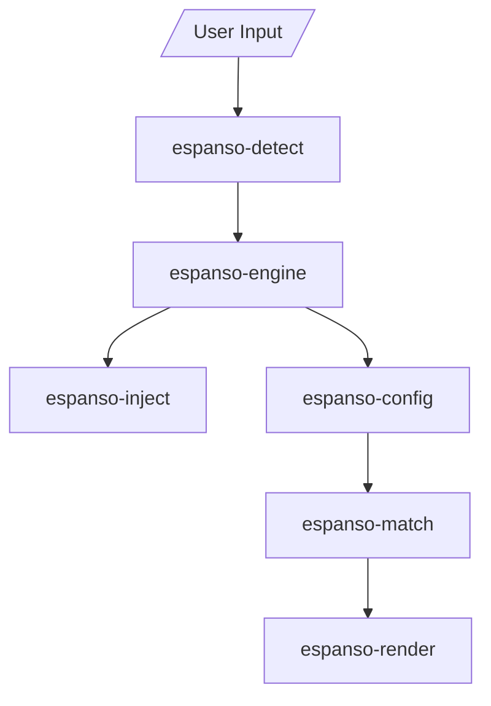

# espanso/espanso

> Cross-platform text expander written in Rust: you type a keyword and it replaces it everywhere.

## The problem
Retyping the same sentences, code snippets or emojis wastes time, and the system autocorrect cannot be customized.

## What it actually does
Detects keywords typed on the keyboard in any program and replaces them with text, dates, script output or shell command output. Configuration through YAML files, regex triggers, forms, per-application configs and packages via espanso hub. Works on Windows, macOS and Linux, with experimental Wayland support. 100% local, with no tracking according to the README.

## How it is wired


## Trying it
```yaml
matches:
  - trigger: ":hello"
    replace: "Hi There!"
  - triggers: [":test1", ":test2"]
    replace: "These both expand to the same thing"
```

## Cost and gotchas
Free, donations possible. Installation is not detailed in the README. Wayland support is experimental.

## What it is not
Not an AI or data tool: a desktop productivity utility. It watches keystrokes, which requires system permissions.

## Alternatives
No alternative named in the README.

## For you
Worth watching: useful for your personal productivity, but unrelated to data, AI or MLOps work.
