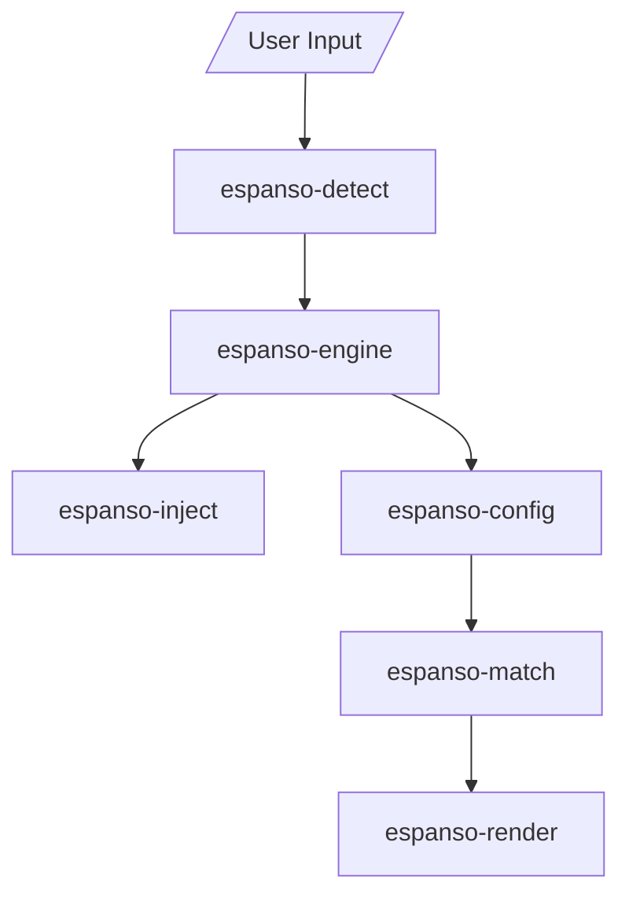

# espanso/espanso

> Expanseur de texte multiplateforme en Rust : tu tapes un mot-clé, il le remplace partout.

## Le problème
Retaper les mêmes phrases, snippets de code ou emojis fait perdre du temps, et l'autocorrection système n'est pas personnalisable.

## Ce que ça fait vraiment
Détecte les mots-clés tapés au clavier dans n'importe quel programme et les remplace par du texte, des dates, la sortie de scripts ou de commandes shell. Configuration par fichiers YAML, déclencheurs regex, formulaires, configs par application et paquets via espanso hub. Fonctionne sur Windows, macOS, Linux, avec Wayland expérimental. 100 % local, sans pistage selon le README.

## Comment c'est branché


## Essayer
```yaml
matches:
  - trigger: ":hello"
    replace: "Hi There!"
  - triggers: [":test1", ":test2"]
    replace: "These both expand to the same thing"
```

## Coût et pièges
Gratuit, dons possibles. L'installation n'est pas détaillée dans le README. Le support Wayland est expérimental.

## Ce que ce n'est pas
Pas un outil d'IA ni de data : un utilitaire de productivité de poste de travail. Il observe les frappes clavier, ce qui demande des droits système.

## Alternatives
Aucune alternative nommée dans le README.

## Pour toi
À surveiller : utile pour ta productivité personnelle, mais sans lien avec un travail data, IA ou MLOps.

