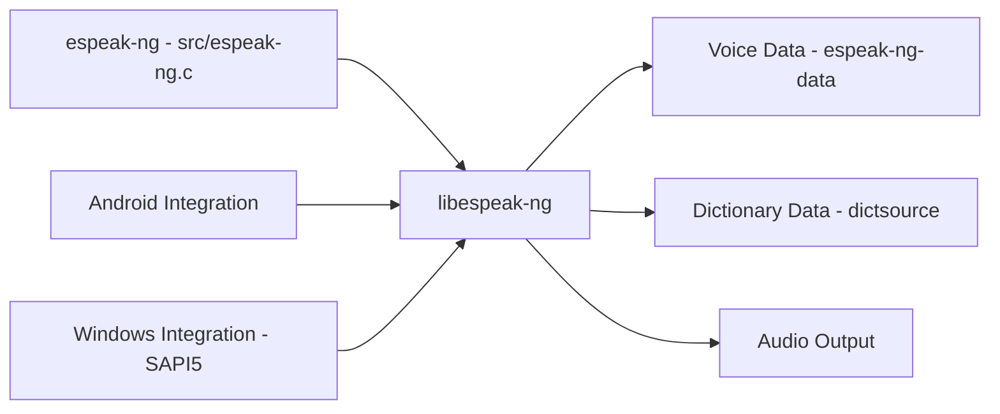

# espeak-ng/espeak-ng

> Compact formant-based speech synthesizer, more than 100 languages, for accessibility and embedded systems.

## The problem
Natural-sounding speech synthesis is heavy; sometimes you need a light, multilingual voice.

## What it actually does
C program and shared library `libespeak-ng`: text → phonemes with pitch and duration → formant synthesis (Klatt possible, MBROLA optional). Output as WAV or direct audio, partial SSML, SAPI5 on Windows. The voice is clear but less natural than models trained on human voices.

## How it is wired


## Trying it
The README points to the guides (user, build). No getting-started command appears in it.

```bash
# non documenté dans le README : voir le guide de compilation
```

## Cost and gotchas
Free. Voices are not very natural; language data are at varying stages of completeness.

## What it is not
Not a neural synthesis. Last push on 2026-09-22 (recent).

## Alternatives
No alternative named in the README (MBROLA cited as a back-end engine).

## For you
Worth watching: useful as a lightweight phonemizer for TTS preprocessing, but not for a natural voice.
