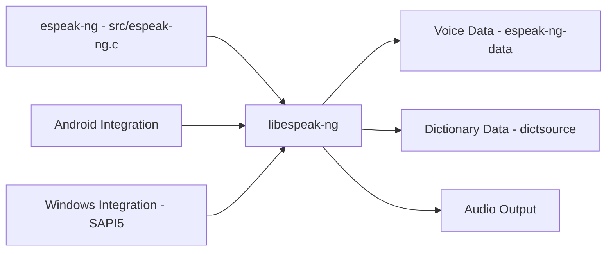

# espeak-ng/espeak-ng

> Synthétiseur vocal compact par formants, plus de 100 langues, pour accessibilité et systèmes embarqués.

## Le problème
Les synthèses vocales naturelles sont lourdes ; il faut parfois une voix légère et multilingue.

## Ce que ça fait vraiment
Programme en C et bibliothèque partagée `libespeak-ng` : texte → phonèmes avec hauteur et durée → synthèse par formants (Klatt possible, MBROLA en option). Sorties WAV ou audio direct, SSML partiel, SAPI5 sous Windows. La voix est claire mais moins naturelle que les modèles entraînés sur voix humaines.

## Comment c'est branché


## Essayer
Le README renvoie aux guides (utilisateur, compilation). Aucune commande de démarrage n'y figure.

```bash
# non documenté dans le README : voir le guide de compilation
```

## Coût et pièges
Gratuit. Voix peu naturelles ; données de langues à des stades variables d'avancement.

## Ce que ce n'est pas
Pas une synthèse neuronale. Dernier push le 2026-09-22 (récent).

## Alternatives
Aucune alternative nommée dans le README (MBROLA cité comme moteur arrière-plan).

## Pour toi
À surveiller : utile comme phonémiseur léger en prétraitement TTS, mais pas pour une voix naturelle.

