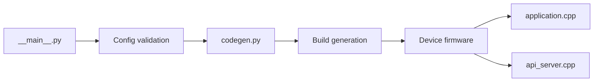

# esphome/esphome

> Turns a configuration into firmware for embedded chips, with a device-state API.

## The problem
Hand-writing firmware for connected devices requires C++ and each platform's build chain.

## What it actually does
Empty README: card based on the code graph alone. The CLI (`__main__.py`) validates the configuration, generates C++ (codegen.py), prepares the framework and libraries (framework.py, library.py), then compiles. On the device, a scheduler (application.cpp) runs the components and a native API (api_server.cpp) exposes the state. The CLI/build links are not verified.

## How it is wired

## Trying it
Not documented: the README is empty.

## Cost and gotchas
Free; you need compatible ESP boards. License present but not identified by GitHub: to be checked.

## What it is not
Cannot be assessed from the text: the card relies on the architecture, not on the author.

## Alternatives
None: the README names nothing.

## For you
Worth watching only if you do IoT or home automation; card not assessable for lack of a README, to be reopened with the project documentation.
