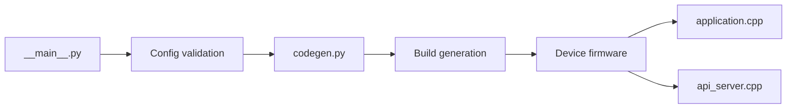

# esphome/esphome

> Transforme une configuration en firmware pour puces embarquées, avec API d'état de l'appareil.

## Le problème
Écrire à la main le firmware d'objets connectés demande du C++ et la chaîne de build de chaque plateforme.

## Ce que ça fait vraiment
README vide : fiche d'après le seul graphe du code. La CLI (`__main__.py`) valide la configuration, génère du C++ (codegen.py), prépare le framework et les bibliothèques (framework.py, library.py) puis compile. Sur l'appareil, un ordonnanceur (application.cpp) fait tourner les composants et une API native (api_server.cpp) expose l'état. Les liens CLI/build ne sont pas vérifiés.

## Comment c'est branché

## Essayer
Non documenté : le README est vide.

## Coût et pièges
Gratuit ; il faut des cartes ESP compatibles. Licence présente mais non identifiée par GitHub : à vérifier.

## Ce que ce n'est pas
Pas évaluable sur le texte : la fiche s'appuie sur l'architecture, pas sur l'auteur.

## Alternatives
Aucune : le README ne nomme rien.

## Pour toi
À surveiller seulement si tu fais de l'IoT ou de la domotique ; fiche non évaluable faute de README, à rouvrir avec la documentation du projet.

