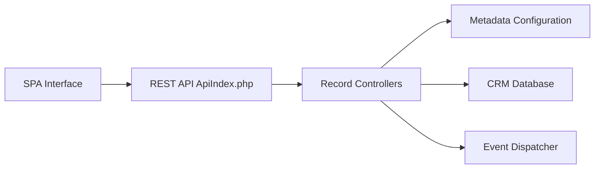

# espocrm/espocrm

> Self-hosted open source CRM, with a single-page interface and a PHP REST API, for SMEs and developers.

## The problem
Tracking contacts, opportunities, campaigns and support requires a central tool, adaptable without being locked in to a vendor.

## What it actually does
Web application: SPA frontend and PHP REST backend, JSON metadata, customizable entities and fields. Features: email, import, lead capture, OAuth, attachments, jobs, access control, staged pipelines.

## How it is wired


## Trying it
```bash
# non documenté dans le README : liens vers installation manuelle, script, Docker et Traefik
```

## Cost and gotchas
PHP 8.3 to 8.5 and MySQL 8 / MariaDB 10.6 / PostgreSQL 15. AGPL-3.0 license: obligations if you offer the service to third parties.

## What it is not
Not a data/AI tool. The architecture mostly details the pipelines.

## Alternatives
- None cited in the README.

## For you
Ignore: a CRM does not fit into a data/AI/MLOps workflow, and the AGPL complicates any integration.
