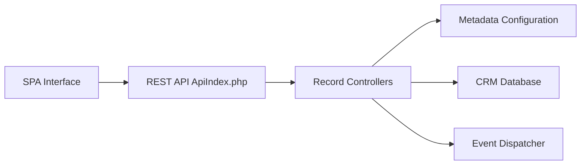

# espocrm/espocrm

> CRM open source auto-hébergé, à interface monopage et API REST PHP, pour PME et développeurs.

## Le problème
Suivre contacts, opportunités, campagnes et support exige un outil central, adaptable sans être captif d'un éditeur.

## Ce que ça fait vraiment
Application web : frontend SPA et backend REST en PHP, métadonnées en JSON, entités et champs personnalisables. Fonctions : e-mail, import, capture de prospects, OAuth, pièces jointes, jobs, contrôle d'accès, pipelines à étapes.

## Comment c'est branché


## Essayer
```bash
# non documenté dans le README : liens vers installation manuelle, script, Docker et Traefik
```

## Coût et pièges
PHP 8.3 à 8.5 et MySQL 8 / MariaDB 10.6 / PostgreSQL 15. Licence AGPL-3.0 : obligations si tu proposes le service à des tiers.

## Ce que ce n'est pas
Pas un outil data/IA. L'architecture détaille surtout les pipelines.

## Alternatives
- Aucune citée dans le README.

## Pour toi
À ignorer : un CRM n'entre pas dans un flux data/IA/MLOps, et l'AGPL complique toute intégration.

