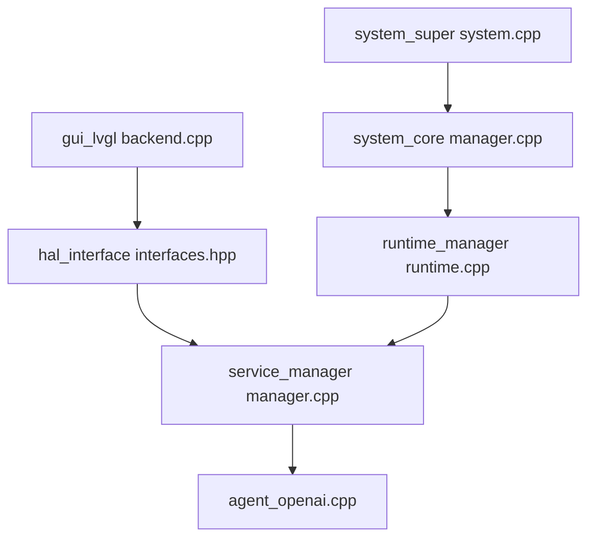

# espressif/esp-brookesia

> ESP-IDF component platform for AIoT products and human-machine interfaces, for anyone developing on Espressif chips.

## The problem
Every embedded product reassembles HAL, services, interface and applications by hand, with no common base.

## What it actually does
Independent C/C++ components published on the Espressif registry: hardware abstraction (with Linux and WebAssembly simulation), service manager, JSON-described interface rendered by LVGL, app runtimes (ELF, JS, Lua, WASM) and a "Super" system for touchscreens. AI agent adapters (Coze, OpenAI, XiaoZhi) and an MCP bridge expose functions to LLMs.

## How it is wired


## Trying it
```bash
git clone https://github.com/espressif/esp-brookesia
```
The README points to the documentation and the Espressif component registry for the rest.

## Cost and gotchas
An ESP32 board and ESP-IDF 6.0 to 6.2 for the master branch (v0.8). The agent adapters call third-party services at your expense; the master branch may contain unstabilized features.

## What it is not
Not a ready-to-flash application, but a set of building blocks. No GPU or embedded model: AI goes through external providers.

## Alternatives
No alternative cited in the README.

## For you
Worth watching: interesting for prototyping a voice assistant or an AI screen on ESP32, of no interest if you do not do embedded work.
