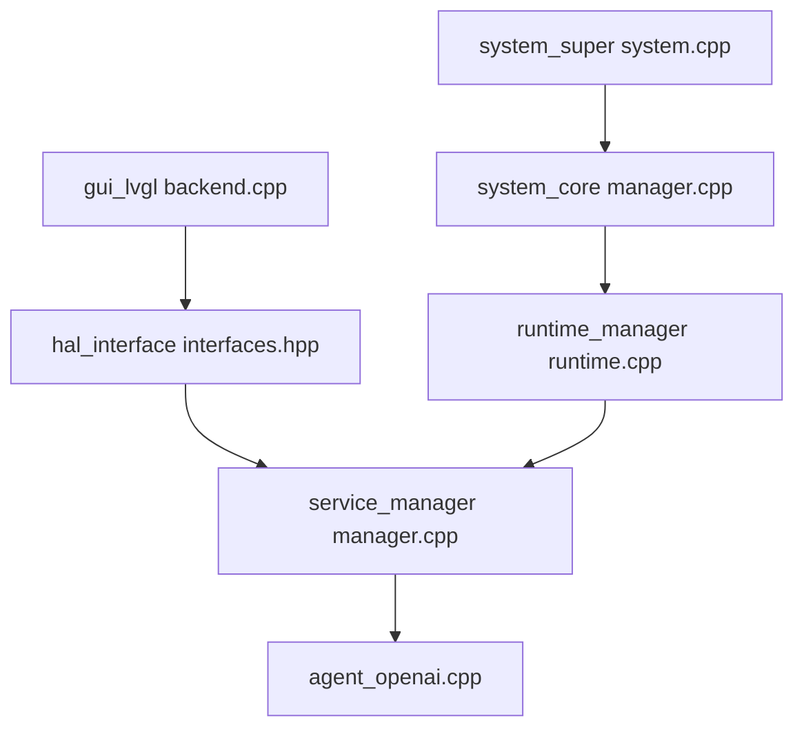

# espressif/esp-brookesia

> Plateforme de composants ESP-IDF pour produits AIoT et interfaces homme-machine, pour qui développe sur puces Espressif.

## Le problème
Chaque produit embarqué réassemble HAL, services, interface et applications à la main, sans base commune.

## Ce que ça fait vraiment
Des composants C/C++ indépendants publiés sur le registre Espressif : abstraction matérielle (avec simulation Linux et WebAssembly), gestionnaire de services, interface décrite en JSON rendue par LVGL, runtimes d'apps (ELF, JS, Lua, WASM) et système « Super » pour écrans tactiles. Des adaptateurs d'agents IA (Coze, OpenAI, XiaoZhi) et un pont MCP exposent des fonctions aux LLM.

## Comment c'est branché


## Essayer
```bash
git clone https://github.com/espressif/esp-brookesia
```
Le README renvoie à la documentation et au registre de composants Espressif pour le reste.

## Coût et pièges
Carte ESP32 et ESP-IDF 6.0 à 6.2 pour la branche master (v0.8). Les adaptateurs d'agents appellent des services tiers à ta charge ; la branche master peut contenir des fonctions non stabilisées.

## Ce que ce n'est pas
Pas une application prête à flasher, mais un ensemble de briques. Pas de GPU ni de modèle embarqué : l'IA passe par des fournisseurs externes.

## Alternatives
Aucune alternative citée dans le README.

## Pour toi
Surveiller : intéressant pour prototyper un assistant vocal ou un écran IA sur ESP32, sans intérêt si tu ne fais pas d'embarqué.

