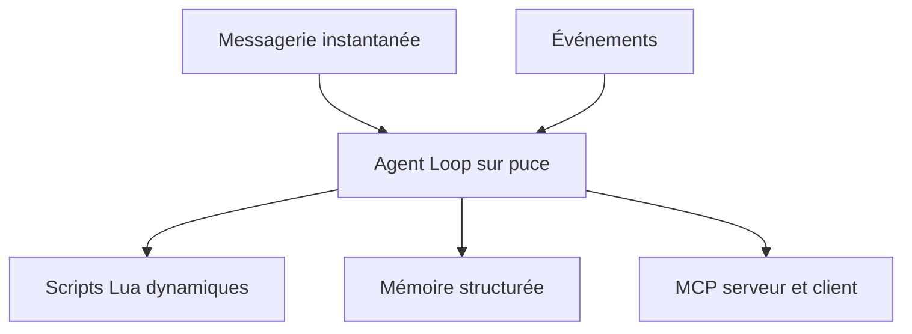

# espressif/esp-claw

> AI agent framework in C for Espressif chips, which defines behavior through conversation.

## The problem
Connected devices execute orders but decide nothing, and their logic is hard-coded.

## What it actually does
An agent loop that runs on an ESP32 chip: trigger events, dynamic loading of Lua scripts via chat in a messaging app, structured memory, MCP communication as both server and client. Supported boards: ESP32-S3, P4, C5 and S31 (M5Stack CoreS3 among others), with online flashing from the browser.

## How it is wired
Simplified diagram based on the card, no diagram provided.

## Trying it
Not documented as a command line in the README: flash a board listed in `./application/edge_agent/boards/` from the browser, or follow the local build documentation.

## Cost and gotchas
An ESP32 board costs a few euros. The language model used is not specified in the README: an API key is likely. The project is not part of Espressif's security bounty program.

## What it is not
Not a finished application: the project is under active development, with a task list and a survey in Chinese. Not an embedded model: the README does not say where the reasoning runs.

## Alternatives
The README cites the OpenClaw concept it draws inspiration from, without detailing it.

## For you
Keep an eye on it: an embedded AI agent with MCP, an interesting signal for edge AI, but young and centered on Espressif hardware.
