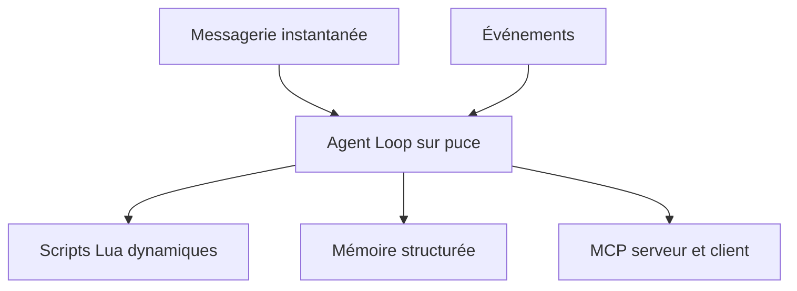

# espressif/esp-claw

> Cadre d'agent IA en C pour puces Espressif, qui définit le comportement par conversation.

## Le problème
Les objets connectés exécutent des ordres mais ne décident rien, et leur logique se programme en dur.

## Ce que ça fait vraiment
Une boucle d'agent qui tourne sur puce ESP32 : événements déclencheurs, chargement dynamique de scripts Lua via discussion en messagerie, mémoire structurée, communication MCP en serveur comme en client. Cartes prises en charge : ESP32-S3, P4, C5 et S31 (M5Stack CoreS3 entre autres), flashage en ligne depuis le navigateur.

## Comment c'est branché
Schéma simplifié d'après la fiche, sans diagramme fourni.

## Essayer
Non documenté en ligne de commande dans le README : flasher une carte listée dans `./application/edge_agent/boards/` depuis le navigateur, ou suivre la documentation de compilation locale.

## Coût et pièges
Une carte ESP32 à quelques euros. Le modèle de langage utilisé n'est pas précisé dans le README : une clé d'API est probable. Le projet n'est pas dans le programme de primes de sécurité d'Espressif.

## Ce que ce n'est pas
Pas une application finie : le projet est en développement actif, avec une liste de tâches et un sondage en chinois. Pas un modèle embarqué : le README ne dit pas où tourne le raisonnement.

## Alternatives
Le README cite le concept OpenClaw dont il s'inspire, sans le détailler.

## Pour toi
À surveiller : agent IA embarqué avec MCP, signal intéressant pour l'IA en périphérie, mais jeune et centré sur le matériel Espressif.

