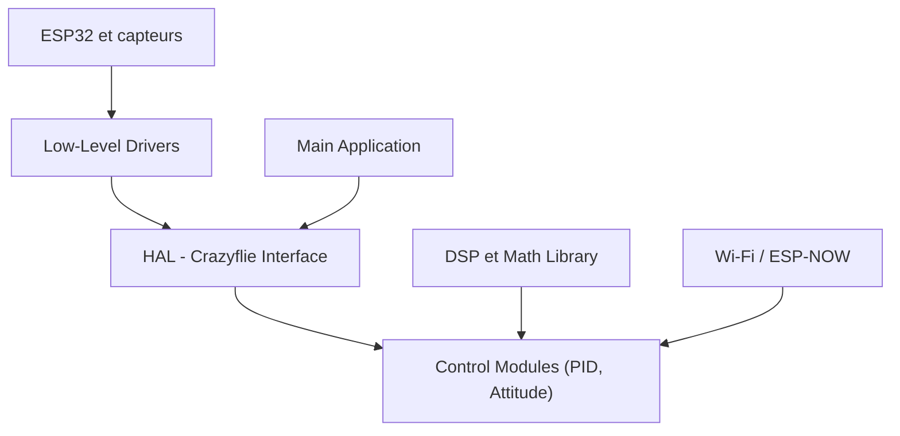

# espressif/esp-drone

> Drone firmware for Espressif chips, controlled over Wi-Fi by app or gamepad, for education.

## The problem
Building a small drone requires an inexpensive flight controller, sensors and a radio link.

## What it actually does
An ESP-IDF firmware for ESP32 whose flight core derives from the Crazyflie project. It offers stabilized, altitude-hold and position-hold modes (the last two require expansion boards), controlled by mobile app, gamepad, cfclient or ESP-BOX-3 via ESP-NOW. The structure includes HAL, control modules, drivers and a DSP library. Only the ESP-IDF branches release/v5.5 and release/v6.1 are supported.

## How it is wired

## Trying it
No command documented in the README: it points to the Getting Started page of the documentation.

## Cost and gotchas
Free (GPL-3.0). Specific hardware and ESP-IDF are required and, for P4 and S31, boards and pinouts must be validated yourself. The real requirement is an ESP-IDF toolchain.

## What it is not
It is not a ready-to-fly drone or a certified autopilot. It is not a data or AI tool.

## Alternatives
No alternative named in the README (it cites Crazyflie as the origin of the flight core).

## For you
Ignore: an embedded drone project has no link with data, AI or MLOps work, except as an electronics hobby.
