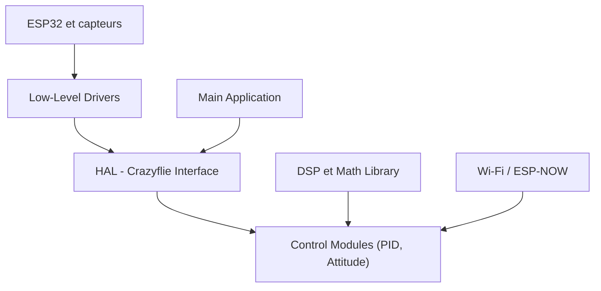

# espressif/esp-drone

> Micrologiciel de drone pour puces Espressif, piloté en Wi-Fi par application ou manette, pour l'éducation.

## Le problème
Construire un petit drone demande un contrôleur de vol, des capteurs et une liaison radio peu coûteux.

## Ce que ça fait vraiment
Un firmware ESP-IDF pour ESP32 dont le cœur de vol dérive du projet Crazyflie. Il propose les modes stabilisé, maintien d'altitude et maintien de position (ces deux derniers demandent des cartes d'extension), pilotés par application mobile, manette, cfclient ou ESP-BOX-3 via ESP-NOW. La structure comprend HAL, modules de contrôle, pilotes et bibliothèque DSP. Seules les branches ESP-IDF release/v5.5 et release/v6.1 sont prises en charge.

## Comment c'est branché

## Essayer
Aucune commande documentée dans le README : il renvoie à la page Getting Started de la documentation.

## Coût et pièges
Gratuit (GPL-3.0). Il faut du matériel spécifique, ESP-IDF et, pour P4 et S31, des cartes et brochages à valider soi-même. Le besoin réel est une chaîne ESP-IDF.

## Ce que ce n'est pas
Ce n'est pas un drone prêt à voler ni un autopilote certifié. Ce n'est pas un outil de data ou d'IA.

## Alternatives
Aucune alternative nommée dans le README (il cite Crazyflie comme origine du cœur de vol).

## Pour toi
À ignorer : un projet de drone embarqué n'a pas de lien avec un travail data, IA ou MLOps, sauf loisir d'électronique.

