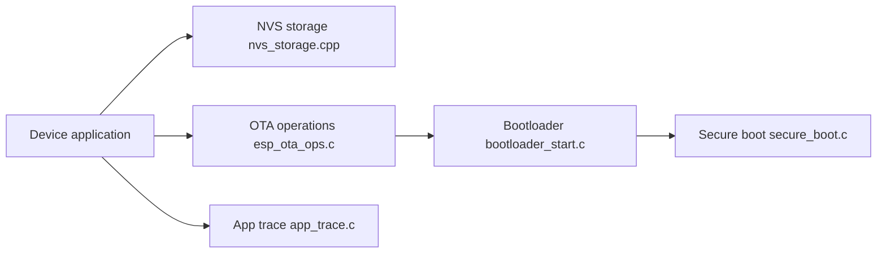

# espressif/esp-idf

> Official firmware development framework for Espressif chips (ESP32 and related).

## The problem
Writing firmware for a Wi-Fi/Bluetooth microcontroller requires a consistent toolchain, bootloader, partitions and drivers.

## What it actually does
Provides a build toolchain (`idf.py`), configuration (`menuconfig`), compilation, flashing, serial monitor. The code shows the device lifecycle: OTA operations, bootloader and secure boot, NVS storage, TEE secure storage, Bluetooth bonding storage, application tracing (UART/JTAG), hardware SHA API. Works on Windows, Linux, macOS.

## How it is wired


## Trying it
```bash
./install.sh
source export.sh
idf.py set-target <cible>
idf.py menuconfig
idf.py build
idf.py -p PORT flash monitor
```

## Cost and gotchas
Free; Espressif hardware required. Each SoC and each version has its own documentation. Forks outside GitHub: run `tools/set-submodules-to-github.sh`. ESP8266/ESP8285 fall under another SDK (RTOS SDK).

## What it is not
Not an embedded AI framework in itself; the README does not mention it. Tightly coupled to Espressif chips.

## Alternatives
RTOS SDK for ESP8266/ESP8285 (cited by the README).

## For you
Relevant only if you deploy edge workloads on ESP32; otherwise ignore.
