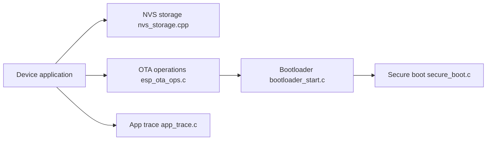

# espressif/esp-idf

> Framework officiel de développement firmware pour les puces Espressif (ESP32 et assimilées).

## Le problème
Écrire un firmware pour microcontrôleur Wi-Fi/Bluetooth exige chaîne de compilation, bootloader, partitions et pilotes cohérents.

## Ce que ça fait vraiment
Fournit chaîne de build (`idf.py`), configuration (`menuconfig`), compilation, flashage, moniteur série. Le code montre le cycle de vie appareil : opérations OTA, bootloader et secure boot, stockage NVS, stockage sécurisé TEE, stockage de liaisons Bluetooth, traçage applicatif (UART/JTAG), API SHA matérielle. Fonctionne sous Windows, Linux, macOS.

## Comment c'est branché


## Essayer
```bash
./install.sh
source export.sh
idf.py set-target <cible>
idf.py menuconfig
idf.py build
idf.py -p PORT flash monitor
```

## Coût et pièges
Gratuit ; matériel Espressif requis. Chaque SoC et chaque version a sa documentation. Forks hors GitHub : lancer `tools/set-submodules-to-github.sh`. ESP8266/ESP8285 relèvent d'un autre SDK (RTOS SDK).

## Ce que ce n'est pas
Pas un framework d'IA embarquée en soi ; le README n'en parle pas. Couplage fort aux puces Espressif.

## Alternatives
RTOS SDK pour ESP8266/ESP8285 (cité par le README).

## Pour toi
Pertinent seulement si tu déploies de l'edge sur ESP32 ; sinon à ignorer.

