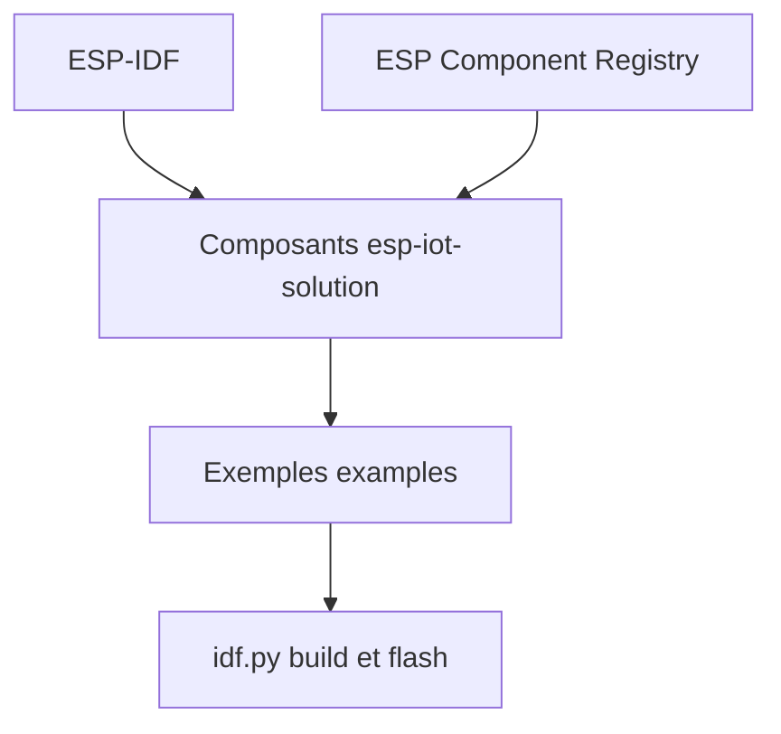

# espressif/esp-iot-solution

> Espressif drivers and components for ESP-IDF: sensors, displays, audio, USB, Bluetooth and low power.

## The problem
Connecting a sensor or display to an ESP32 forces you to rewrite drivers that already exist.

## What it actually does
Collection of components distributed through the ESP Component Registry: drivers for sensors (aht20, bme280), LCD displays, touch, buttons, USB host and device, BLE, as well as building blocks like `openai`, `mcp-c-sdk` or `quickjs-ng`. Examples built with `idf.py`. The master branch requires ESP-IDF 5.3 or later.

## How it is wired
Simplified diagram based on the sheet, no diagram provided.



## Trying it
```bash
idf.py add-dependency "espressif/usb_stream"
git clone --recursive https://github.com/espressif/esp-iot-solution
cd examples/usb/host/usb_audio_player
idf.py set-target esp32s3
idf.py build
idf.py -p /dev/ttyUSB0 flash monitor
```

## Cost and gotchas
Free. Requires the ESP-IDF environment installed and an Espressif board. Component versions depend on different ESP-IDF versions (see their `idf_component.yml`).

## What it is not
Not an operating system nor an AI framework: drivers and examples for microcontrollers.

## Alternatives
No alternative named in the README.

## For you
Ignore unless you have an embedded AI project on ESP32: it is hardware, far from classic MLOps.
