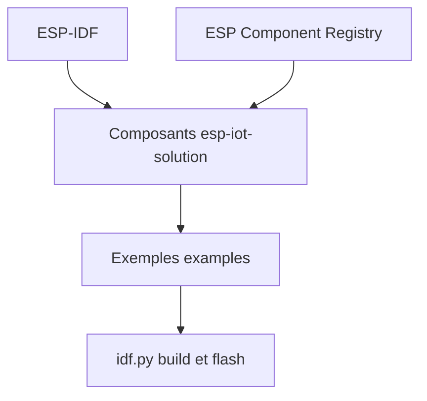

# espressif/esp-iot-solution

> Pilotes et composants Espressif pour ESP-IDF : capteurs, écrans, audio, USB, Bluetooth et basse consommation.

## Le problème
Brancher un capteur ou un écran sur un ESP32 oblige à réécrire des pilotes déjà existants.

## Ce que ça fait vraiment
Collection de composants distribués par l'ESP Component Registry : pilotes de capteurs (aht20, bme280), d'écrans LCD, tactiles, boutons, USB hôte et périphérique, BLE, ainsi que des briques comme `openai`, `mcp-c-sdk` ou `quickjs-ng`. Exemples compilés avec `idf.py`. La branche master exige ESP-IDF 5.3 ou plus.

## Comment c'est branché
Schéma simplifié d'après la fiche, sans diagramme fourni.



## Essayer
```bash
idf.py add-dependency "espressif/usb_stream"
git clone --recursive https://github.com/espressif/esp-iot-solution
cd examples/usb/host/usb_audio_player
idf.py set-target esp32s3
idf.py build
idf.py -p /dev/ttyUSB0 flash monitor
```

## Coût et pièges
Gratuit. Exige l'environnement ESP-IDF installé et une carte Espressif. Les versions de composants dépendent de versions d'ESP-IDF différentes (voir leur `idf_component.yml`).

## Ce que ce n'est pas
Pas un système d'exploitation ni un framework d'IA : des pilotes et exemples pour microcontrôleurs.

## Alternatives
Aucune alternative nommée dans le README.

## Pour toi
À ignorer sauf projet d'IA embarquée sur ESP32 : c'est du matériel, loin du MLOps classique.

