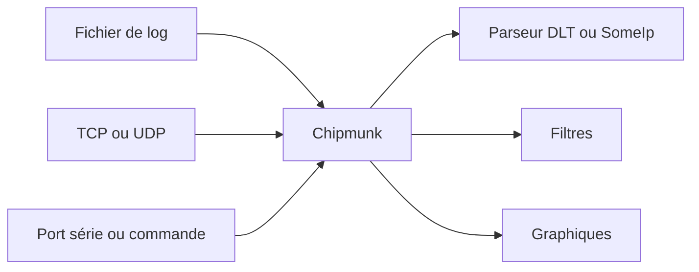

# esrlabs/chipmunk

> Rust desktop application for reading and filtering log files of unlimited size.

## The problem
Opening a multi-gigabyte log file in a classic editor is slow or impossible.

## What it actually does
Opens large files without copying, at constant speed. Also collects live logs over TCP, UDP, serial port or command output. Handles the automotive formats DLT and SomeIp, including attachments, in pcap or pcapng captures. Saved, colored filters updated in real time, and charts drawn from metrics via regular expressions.

## How it is wired
Simplified diagram based on the fiche, no diagram provided.

## Trying it
No command documented in the README; it points to the online documentation for installation.

## Cost and gotchas
Free. The installation method is not documented in the README. 126 open issues according to the catalog.

## What it is not
Not a centralized log platform (like ELK): it is a desktop tool for a single workstation. The automotive formats are a strength, not a requirement.

## Alternatives
No alternative named in the README.

## For you
Worth watching: handy for digging through large training logs or inference server logs, with no infrastructure commitment.
