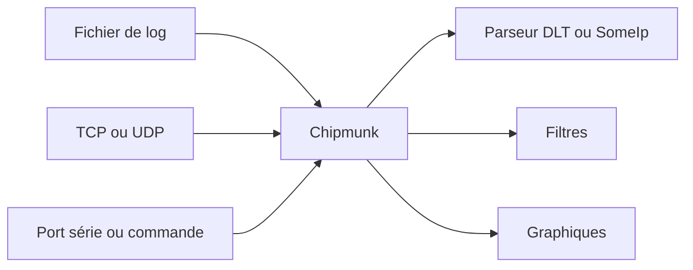

# esrlabs/chipmunk

> Application de bureau en Rust pour lire et filtrer des fichiers de logs de taille illimitée.

## Le problème
Ouvrir un fichier de log de plusieurs gigaoctets dans un éditeur classique est lent ou impossible.

## Ce que ça fait vraiment
Ouvre des fichiers volumineux sans copie, à vitesse constante. Collecte aussi des logs en direct par TCP, UDP, port série ou sortie de commande. Gère les formats automobiles DLT et SomeIp, y compris pièces jointes, dans des captures pcap ou pcapng. Filtres sauvegardés et colorés, mis à jour en temps réel, et graphiques tirés de métriques par expressions régulières.

## Comment c'est branché
Schéma simplifié d'après la fiche, sans diagramme fourni.

## Essayer
Aucune commande documentée dans le README ; il renvoie à la documentation en ligne pour l'installation.

## Coût et pièges
Gratuit. Le mode d'installation n'est pas documenté dans le README. 126 issues ouvertes d'après le catalogue.

## Ce que ce n'est pas
Pas une plateforme de logs centralisée (type ELK) : c'est un outil de bureau pour un poste. Les formats automobiles sont un point fort, pas une obligation.

## Alternatives
Aucune alternative nommée dans le README.

## Pour toi
À surveiller : pratique pour fouiller de gros logs d'entraînement ou de serveurs d'inférence, sans engagement d'infrastructure.

