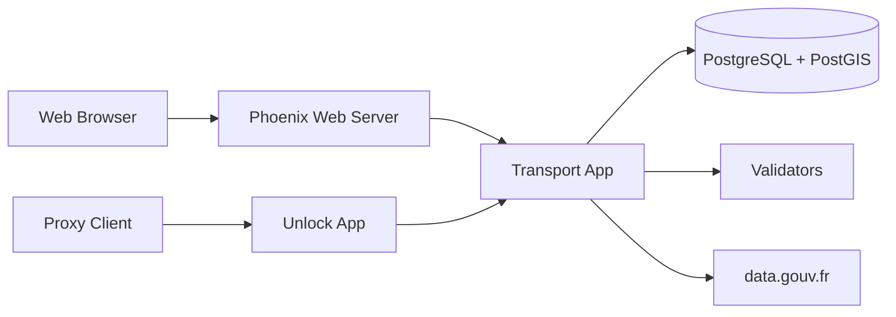

# etalab/transport-site

> Site of the French National Access Point for mobility data, built on data.gouv.fr, for its developers.

## The problem
Transport data (schedules, real time) is scattered across authorities. A single point is needed to publish, validate and expose it.

## What it actually does
Elixir/Phoenix umbrella application (`transport`, `datagouvfr`, `shared`, `unlock`). It imports and validates datasets, authenticates via data.gouv.fr OAuth, and processes background jobs. `unlock` is a proxy that caches (configurable TTL) GTFS-RT feeds hidden behind a public URL. A LiveView back office tracks the feeds.

## How it is wired


## Trying it
```bash
mix deps.get
mix yarn install
mix ecto.create
mix ecto.migrate
mix phx.server
```
Or `docker-compose up` then http://localhost:5000.

## Cost and gotchas
Free, but Elixir, Erlang, Node, Yarn and PostgreSQL/PostGIS are required. The production database is retrieved via a Clever Cloud backup (permissions needed). Login requires staging OAuth credentials.

## What it is not
Not a reusable library: it is the code of one specific government site. No license declared, so reuse is legally unclear.

## Alternatives
None cited in the README.

## For you
Ignore: an Elixir site specific to French mobility, unlicensed, useful only as an example of Phoenix/GTFS-RT proxy architecture.
