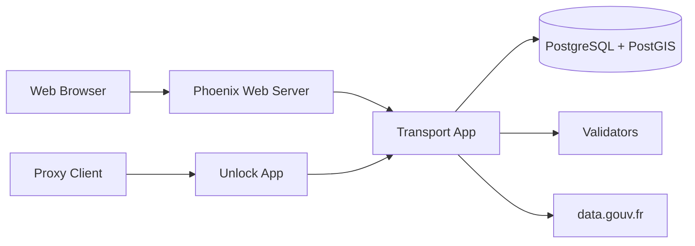

# etalab/transport-site

> Site du Point d'Accès National français aux données de mobilité, bâti sur data.gouv.fr, pour ses développeurs.

## Le problème
Les données de transport (horaires, temps réel) sont dispersées chez les autorités. Il faut un point unique pour les publier, les valider et les exposer.

## Ce que ça fait vraiment
Application Elixir/Phoenix en umbrella (`transport`, `datagouvfr`, `shared`, `unlock`). Elle importe et valide des jeux de données, authentifie via OAuth data.gouv.fr, traite des jobs en arrière-plan. `unlock` est un proxy qui met en cache (TTL configurable) des flux GTFS-RT cachés derrière une URL publique. Un back-office LiveView suit les flux.

## Comment c'est branché


## Essayer
```bash
mix deps.get
mix yarn install
mix ecto.create
mix ecto.migrate
mix phx.server
```
Ou `docker-compose up` puis http://localhost:5000.

## Coût et pièges
Gratuit, mais Elixir, Erlang, Node, Yarn, PostgreSQL/PostGIS requis. La base de prod se récupère via une sauvegarde Clever Cloud (permissions nécessaires). Le login demande des identifiants OAuth de staging.

## Ce que ce n'est pas
Pas une bibliothèque réutilisable : c'est le code d'un site gouvernemental précis. Aucune licence déclarée, donc réutilisation juridiquement floue.

## Alternatives
Aucune citée dans le README.

## Pour toi
Ignorer : c'est un site Elixir spécifique à la mobilité française, sans licence, utile seulement comme exemple d'architecture Phoenix/proxy GTFS-RT.

