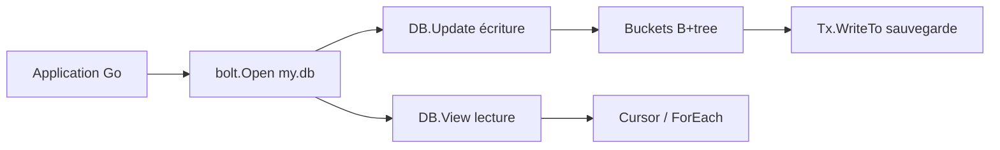

# etcd-io/bbolt

> Embedded key/value database in pure Go, single file, serializable ACID transactions.

## The problem
Storing durable local state without standing up a Postgres: the alternatives either require a server,
or offer no transactions, or fall into disuse like the original Bolt.

## What it actually does
Maintained fork of Bolt, inspired by LMDB. A database is a **single file** locked by a single
process. `DB.Update` opens a write transaction (only one at a time), `DB.View` as many concurrent
reads as you like, `DB.Batch` groups concurrent writes. Data lives
in buckets, possibly nested, traversed with `Cursor` (`First`, `Seek`, `Next`), prefix or
range scans. `Tx.WriteTo` makes a hot backup from a read transaction.

## How it is wired


## Trying it
```sh
go get go.etcd.io/bbolt@latest
go run go.etcd.io/bbolt/cmd/bbolt@latest
go install go.etcd.io/bbolt/cmd/bbolt@latest
```

## Cost and gotchas
Free. Only one process can open the database: a second open **blocks** until it is closed,
unless `Options{Timeout}` is set. Nested or simultaneous transactions in the same goroutine can
cause a deadlock. Returned values are valid only during the transaction: using them
afterwards causes an `unexpected fault address` panic; you must `copy()`.

## What it is not
Not a relational database: key access only, no joins, no SQL.
Not a server: multi-process access is impossible. A poor choice for intensive random writes
(>10,000 writes/s) or spinning disks. Avoid long read transactions, which
prevent page reclamation. README truncated at the source at the end of the "Caveats" section.

## Alternatives
- **LevelDB / RocksDB**: LSM-tree, better at random writes, but without transactions.
- **LMDB**: architectural ancestor, faster, at the price of unsafe operations.
- **SQLite**: embedded like bbolt, but with SQL and its parsing and planning overhead.

## For you
The right reflex for a cache or local state in a Go service; of no interest on the Python side.
