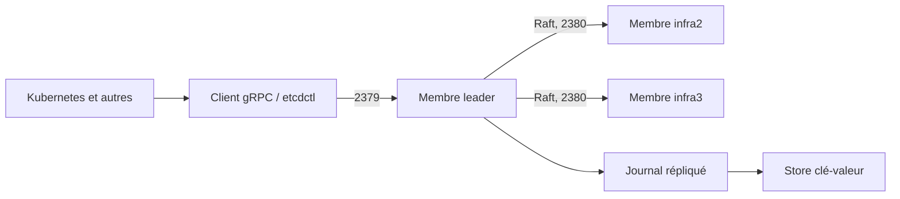

# etcd-io/etcd

> Distributed, reliable key-value store for the critical data of a distributed system.

## The problem
Coordinating several nodes — leader election, locks, shared configuration — without a consistent store always ends in silent inconsistencies.

## What it actually does
A replicated key-value store with a well-defined gRPC API, automatic TLS and optional client-certificate authentication, measured at 10,000 writes/second. Written in Go, it uses the Raft consensus algorithm to manage a highly available replicated log. A command-line client, `etcdctl`, covers everyday use. Rigorous robustness tests complete the validation; etcd is used in production notably by Kubernetes.

## How it is wired


## Trying it
```bash
etcd
etcdctl put mykey "this is awesome"
etcdctl get mykey
goreman start
go get go.etcd.io/etcd/client/v3
```

## Cost and gotchas
Free. The `main` branch may be unstable, even broken, during development: use only released versions. Two official ports: 2379 for clients, 2380 between peers. A local test cluster requires `goreman`.

## What it is not
It is not a general-purpose database: it is built for small, critical coordination data, not for application storage. The README documents neither sizing, retention, nor backup: all of that is in the operations guide.

## Alternatives
No alternative named in the README.

## For you
Adopt it by osmosis: if you run Kubernetes, you already operate it — knowing `etcdctl` and the two ports is the bare minimum.
