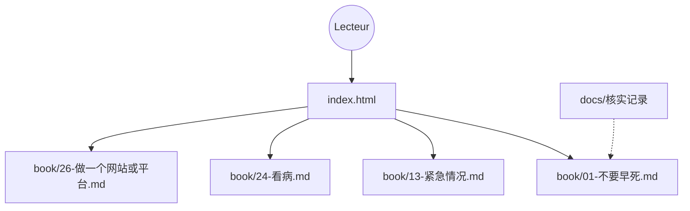

# eternity4719/HowToLiveBetter

> Chinese collection of 772 sourced tips on health, money and law, for readers living in mainland China.

## The problem
Life advice circulates without evidence or stated cost. Here each entry says what it costs, what it brings and how solid its source is.

## What it actually does
A book in 34 chapters of Markdown, with a static search page filterable by keyword, chapter or evidence level. Exports (PDF, EPUB, offline HTML, Anki) are generated. A skill for Claude Code and Codex queries the book. The law and benefits described are those of mainland China.

## How it is wired


## Trying it
```bash
git clone https://github.com/eternity4719/HowToLiveBetter.git
cd HowToLiveBetter
python -m http.server 8000
```

## Cost and gotchas
Free, no dependencies. `index.html` must be served over http; double-clicking it locally gives a blank page. Content is in Chinese, with Chinese legal norms, sometimes outdated according to the author.

## What it is not
Not a data tool nor reusable code. Not medical or legal advice. Not applicable outside mainland China.

## Alternatives
No alternative named in the README.

## For you
Ignore it: the content is practical law and health specific to China, unrelated to a data / AI / MLOps profile.
