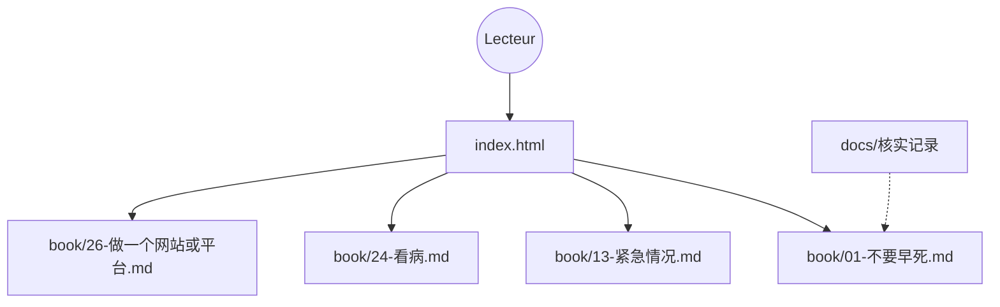

# eternity4719/HowToLiveBetter

> Recueil chinois de 772 conseils sourcés sur santé, argent et droit, pour lecteurs vivant en Chine continentale.

## Le problème
Les conseils de vie circulent sans preuves ni coût indiqués. Ici chaque entrée dit ce qu'elle coûte, ce qu'elle rapporte et la solidité de la source.

## Ce que ça fait vraiment
Un livre en 34 chapitres de Markdown, avec une page de recherche statique filtrable par mot-clé, chapitre ou niveau de preuve. Des exports (PDF, EPUB, HTML hors ligne, Anki) sont générés. Un skill pour Claude Code et Codex interroge le livre. Le droit et les aides décrits sont ceux de la Chine continentale.

## Comment c'est branché


## Essayer
```bash
git clone https://github.com/eternity4719/HowToLiveBetter.git
cd HowToLiveBetter
python -m http.server 8000
```

## Coût et pièges
Gratuit, aucune dépendance. `index.html` doit être servi en http, un double-clic local donne une page vide. Contenu en chinois, normes juridiques chinoises, parfois périmées selon l'auteur.

## Ce que ce n'est pas
Pas un outil data ni un code réutilisable. Pas un avis médical ou juridique. Pas applicable hors Chine continentale.

## Alternatives
Aucune alternative nommée dans le README.

## Pour toi
Ignorer : le contenu est du droit et de la santé pratique propres à la Chine, sans lien avec un profil data / IA / MLOps.

