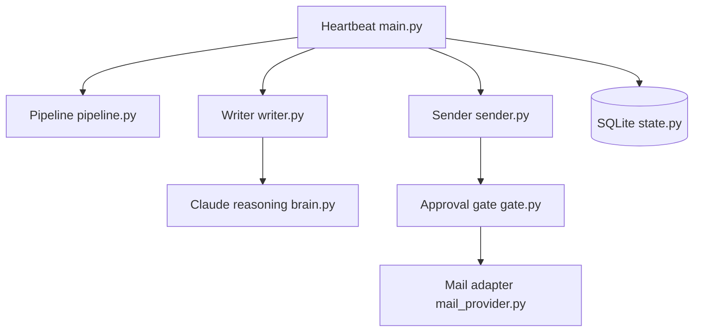

# ethanplusai/harvey

> Local autonomous sales agent that prospects and writes cold emails through your Claude Code subscription.

## The problem
Prospecting tools bill by API usage or from $250-500/month, and sending personalized emails remains manual.

## What it actually does
- Loops every 15 minutes: reply, send, write, prospect, following deterministic rules.
- Discovers companies (OpenStreetMap by default), profiles their websites into signals (29, to be confirmed), finds and verifies contacts.
- Writes the emails with Claude Code (or Codex) outside the API, then a human approves sending in a local dashboard.
- The "skills" are editable Markdown files.

## How it is wired


## Trying it
```bash
python3.13 -m venv .venv && source .venv/bin/activate && pip install -e .
cp .env.example .env && $EDITOR .env
harvey signals --confirm free
harvey discover
harvey dashboard
harvey run
```

## Cost and gotchas
Claude Pro/Max subscription (or ChatGPT with Codex), a dedicated mailbox (~$7/month) and a warmup service recommended. Paid discovery sources optional. The README asks you to check the provider's terms of use.

## What it is not
Not free: "no API bill" does not mean no subscription. Cold emailing has compliance and deliverability issues. README truncated in the supplied source: the end was not read.

## Alternatives
No alternative named in the part of the README that was read (Apollo, ZoomInfo, Clearbit, Clay are cited as tools it replaces).

## For you
Worth watching: the idea of an agent loop on a subscription and an approval gate is instructive, but the use is commercial, not data/AI, and depends on a third party's terms.
