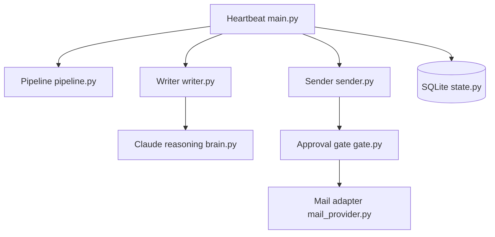

# ethanplusai/harvey

> Agent de vente autonome local, qui prospecte et rédige des mails à froid via ton abonnement Claude Code.

## Le problème
Les outils de prospection facturent à l'usage de l'API ou à partir de 250-500 $/mois, et l'envoi de mails personnalisés reste manuel.

## Ce que ça fait vraiment
- Boucle toutes les 15 minutes : répondre, envoyer, écrire, prospecter, selon des règles déterministes.
- Découvre des entreprises (OpenStreetMap par défaut), profile leurs sites en signaux (29, à confirmer), trouve et vérifie les contacts.
- Rédige les mails avec Claude Code (ou Codex) hors API, puis un humain approuve l'envoi dans un tableau de bord local.
- Les « skills » sont des fichiers Markdown modifiables.

## Comment c'est branché


## Essayer
```bash
python3.13 -m venv .venv && source .venv/bin/activate && pip install -e .
cp .env.example .env && $EDITOR .env
harvey signals --confirm free
harvey discover
harvey dashboard
harvey run
```

## Coût et pièges
Abonnement Claude Pro/Max (ou ChatGPT avec Codex), boîte mail dédiée (~7 $/mois) et service de warmup recommandé. Sources de découverte payantes en option. Le README demande de vérifier les conditions d'usage du fournisseur.

## Ce que ce n'est pas
Pas gratuit : « pas de facture API » ne veut pas dire sans abonnement. Le cold emailing a des enjeux de conformité et de délivrabilité. README tronqué dans la source fournie : la fin n'a pas été lue.

## Alternatives
Aucune alternative nommée dans la partie lue du README (Apollo, ZoomInfo, Clearbit, Clay sont cités comme outils remplacés).

## Pour toi
À surveiller : l'idée d'une boucle agent sur abonnement et d'un portail d'approbation est instructive, mais l'usage est commercial, pas data/IA, et dépend des conditions d'un tiers.

