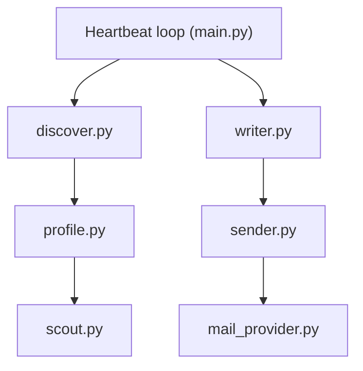

# ethanplusai/sellbird

> Local prospecting agent: finds companies, writes cold emails, sends them and handles replies.

## The problem
Sales prospecting by email chains research, verification, writing and follow-up, all very manual.

## What it actually does
A pipeline: company search (OpenStreetMap or paid sources), reading their website for buying signals, identifying the decision maker, verifying the address, writing sequences, sending via Gmail, Microsoft 365 or SMTP, sorting replies. Nothing is sent without approval by default. Reasoning goes through the Claude Code or Codex CLI.

## How it is wired


## Trying it
```bash
python3.13 -m venv .venv && source .venv/bin/activate && pip install -e .
cp .env.example .env
sellbird train https://your-company.com
sellbird discover
sellbird run
```

## Cost and gotchas
No API bill, but a Claude Pro/Max or ChatGPT subscription, a mailbox (about $7 per month on Google Workspace) and domain warm-up. AGPL-3.0.

## What it is not
Not a simple list tool: it really sends cold emails, with the legal obligations of the targeted country. No deliverability guarantee.

## Alternatives
No alternative named in the README.

## For you
Ignore: commercial prospecting is outside your profile; only the approval-before-sending safeguard is worth a look for your own agents.
