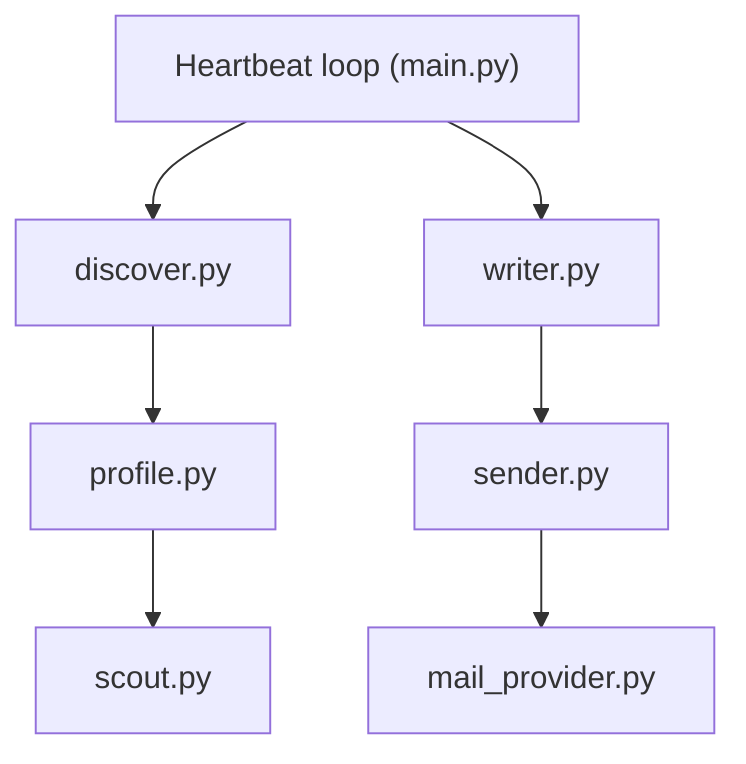

# ethanplusai/sellbird

> Agent local de prospection : trouve des entreprises, écrit des e-mails à froid, les envoie et traite les réponses.

## Le problème
La prospection commerciale par e-mail enchaîne recherche, vérification, rédaction et suivi, très manuels.

## Ce que ça fait vraiment
Un pipeline : recherche d'entreprises (OpenStreetMap ou sources payantes), lecture de leur site pour des signaux d'achat, identification du décideur, vérification de l'adresse, rédaction de séquences, envoi via Gmail, Microsoft 365 ou SMTP, tri des réponses. Rien ne part sans validation par défaut. Le raisonnement passe par le CLI Claude Code ou Codex.

## Comment c'est branché


## Essayer
```bash
python3.13 -m venv .venv && source .venv/bin/activate && pip install -e .
cp .env.example .env
sellbird train https://your-company.com
sellbird discover
sellbird run
```

## Coût et pièges
Pas de facture API, mais un abonnement Claude Pro/Max ou ChatGPT, une boîte mail (environ 7 $ par mois sur Google Workspace) et un échauffement du domaine. AGPL-3.0.

## Ce que ce n'est pas
Pas un simple outil de liste : il envoie réellement des e-mails à froid, avec les obligations légales du pays visé. Aucune garantie de délivrabilité.

## Alternatives
Aucune alternative nommée dans le README.

## Pour toi
À ignorer : prospection commerciale hors de ton profil ; seul le garde-fou d'approbation avant envoi vaut d'être regardé pour tes propres agents.

