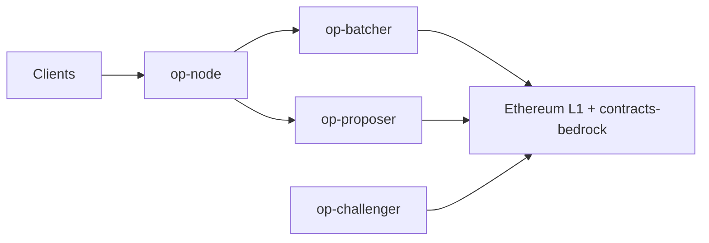

# ethereum-optimism/optimism

> Monorepo of the OP Stack, the software stack of the Optimism and Base L2 blockchains, for rollup operators.

## The problem
Ethereum L1 is expensive and slow; rollups move execution off-chain while keeping L1's security.

## What it actually does
Groups the components: `op-node` (the rollup's consensus client), `op-batcher` (submits batches to L1), `op-proposer`, `op-challenger` (dispute games), `cannon` (MIPS emulator for fraud proofs), the `contracts-bedrock` contracts, and Rust components (kona, op-reth). Only a few components have production releases.

## How it is wired


## Trying it
```bash
curl -L https://github.com/ethereum-optimism/optimism/archive/$REF.tar.gz | tar xz
git clone --depth 1 --shallow-submodules https://github.com/ethereum-optimism/optimism.git
```

## Cost and gotchas
Git history of several GB; contract changes are not backward compatible. Operating a rollup requires heavy infrastructure. Bug bounty program of up to $2,000,042.

## What it is not
Not a data science tool; the README gives no getting-started guide, it points to the docs.

## Alternatives
None named in the README.

## For you
Ignore: blockchain infrastructure unrelated to your data/AI work.
