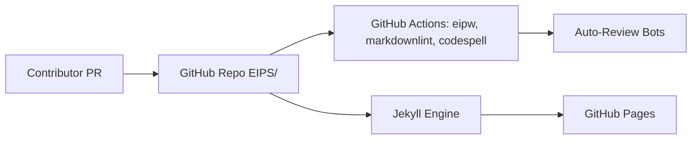

# ethereum/EIPs

> Repository of Ethereum Improvement Proposals (EIPs), read by protocol developers.

## The problem
A decentralized protocol needs a public, versioned process to propose, discuss and freeze its evolutions.

## What it actually does
Contains the EIPs in Markdown, classified as Core, Networking, Interface, Meta, Informational. ERCs have been moved to ethereum/ercs. PRs go through `eipw`, HTMLProofer, CodeSpell, markdownlint and an auto-merge bot. Jekyll generates the site published via GitHub Pages.

## How it is wired


## Trying it
```bash
cargo install eipw
eipw --config ./config/eipw.toml <INPUT FILE / DIRECTORY>
bundle install
bundle exec jekyll serve
```

## Cost and gotchas
Free. The local build requires exactly Ruby 3.1.4 (later versions unsupported). Any idea must first be discussed on Ethereum Magicians or Research.

## What it is not
Not a place for implementation help or technical questions; no executable code.

## Alternatives
No alternative cited in the README.

## For you
Worth watching: a useful reference if you touch blockchain, of no direct interest for a classic data/ML pipeline.
