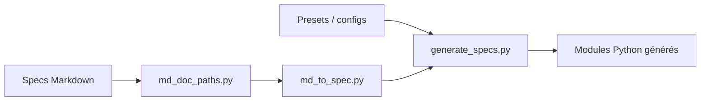

# ethereum/consensus-specs

> Specifications of Ethereum's proof-of-stake consensus layer, for client developers.

## The problem
Several teams implement the same protocol: without an executable reference text, clients diverge.

## What it actually does
Hosts the specs per upgrade (Phase0 to Fulu, with Gloas and Heze still unstable), written in Markdown. A Python generator turns these documents and presets into Python modules per fork. The README also cites online viewers and reference tests (publication not mapped).

## How it is wired

## Trying it
No command documented in the README. Online reading: https://ethereum.github.io/consensus-specs/

## Cost and gotchas
Free. The specs evolve fork by fork; the "unstable" forks (Gloas, Heze) have no fixed epoch.

## What it is not
It is not an Ethereum client: it does not run as a node. CC0 license: no constraint.

## Alternatives
Prysm and Erigon (clients) implement these specs; they do not replace them.

## For you
Useful only if you work on Ethereum; outside that field, of no interest for a data/AI profile: ignore.
