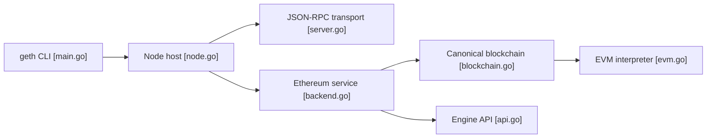

# ethereum/go-ethereum

> An Ethereum client in Go (execution layer) for running a node and exposing JSON-RPC APIs.

## The problem
Interacting with Ethereum (accounts, transfers, contracts) requires joining the peer-to-peer network with a node that validates and executes blocks.

## What it actually does
`geth` syncs the chain (snap mode by default), validates and executes blocks, maintains the state (Merkle Patricia trees), manages the transaction pool and talks to the consensus client through the Engine API. It serves JSON-RPC (HTTP, WebSocket, IPC) and optional GraphQL. Other executables: `abigen`, `evm`, `devp2p`, `rlpdump`.

## How it is wired


## Trying it
```bash
make geth
make all
geth console
geth --sepolia console
docker run -d --name ethereum-node -v /Users/alice/ethereum:/root -p 8545:8545 -p 30303:30303 ethereum/client-go
```

## Cost and gotchas
Minimum: 4 cores, 8 GB of RAM, 2 TB SSD, 8 Mbit/s. Since the Merge, a consensus (beacon) client is mandatory. Never open HTTP/WS without thinking: the README warns of active attacks on exposed APIs. Inconsistency: the README asks for Go 1.25, the architecture description says 1.23.

## What it is not
It is not a complete client on its own, nor an on-chain analytics tool. A private network is no longer simple to set up.

## Alternatives
No alternative named in the README (Kurtosis and Dev mode are for test networks).

## For you
Ignore unless you have an on-chain data project: 2 TB of disk and a consensus client for a need outside classic data/AI.
