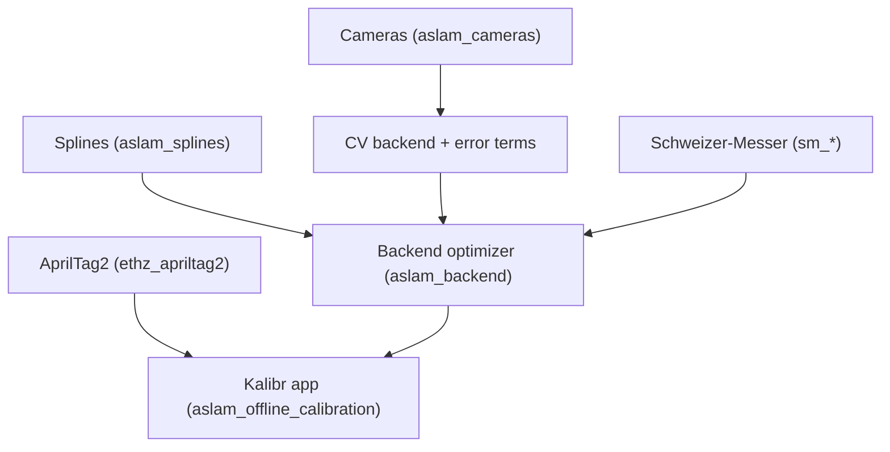

# ethz-asl/kalibr

> Camera and IMU calibration toolbox for robotics, running on ROS1.

## The problem
Fusing multiple sensors (cameras, IMUs) requires knowing their intrinsic parameters, their relative positions and their time offset.

## What it actually does
Calibrates multi-camera systems, camera-IMU, multi-IMU and rolling-shutter cameras. The Python tools read datasets, detect AprilTag targets, build a nonlinear optimization problem (C++ engine aslam_backend, continuous-time splines) and export results and reports.

## How it is wired

## Trying it
No command in the README: it points to the installation wiki page (Docker or ROS workspace).

## Cost and gotchas
Free. Docker or compilation in a ROS1 workspace (Ubuntu 16.04 to 20.04 according to the code). Last push March 2024, 138 open issues. License not identified by GitHub.

## What it is not
Not for ROS2 according to the repository (ROS1). Not a generic perception tool.

## Alternatives
No alternative named in the README.

## For you
Ignore: unless you have a robotics or multi-sensor vision project, outside the data / AI / MLOps scope.
