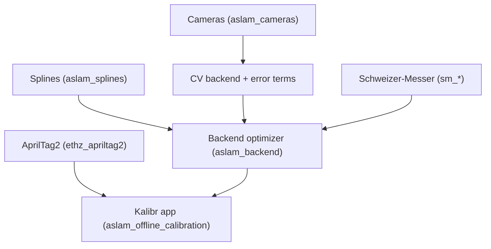

# ethz-asl/kalibr

> Boîte à outils de calibration de caméras et d'IMU pour robotique, sous ROS1.

## Le problème
Fusionner plusieurs capteurs (caméras, IMU) exige de connaître leurs paramètres internes, leurs positions relatives et leur décalage temporel.

## Ce que ça fait vraiment
Calibre des systèmes multi-caméras, caméra-IMU, multi-IMU et caméras à obturateur roulant. Les outils Python lisent les jeux de données, détectent des cibles AprilTag, construisent un problème d'optimisation non linéaire (moteur C++ aslam_backend, splines continus) et exportent résultats et rapports.

## Comment c'est branché

## Essayer
Aucune commande dans le README : renvoi vers la page wiki d'installation (Docker ou ROS workspace).

## Coût et pièges
Gratuit. Docker ou compilation dans un workspace ROS1 (Ubuntu 16.04 à 20.04 d'après le code). Dernier push mars 2024, 138 issues ouvertes. Licence non identifiée par GitHub.

## Ce que ce n'est pas
Pas pour ROS2 d'après le dépôt (ROS1). Pas un outil de perception générique.

## Alternatives
Aucune alternative nommée dans le README.

## Pour toi
Ignorer : sauf projet robotique ou vision multi-capteurs, hors périmètre data / IA / MLOps.

