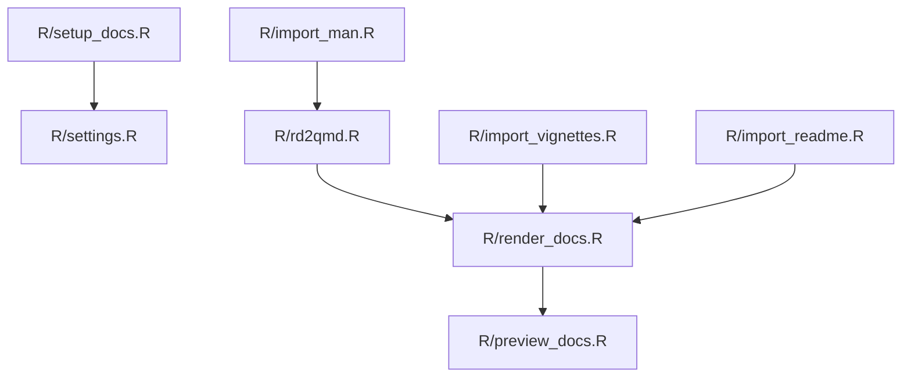

# etiennebacher/altdoc

> R package that creates a documentation site for an R package, with Quarto, Docsify, MkDocs or Docute.

## The problem
Building a documentation site for an R package with vignettes, reference pages and a README requires scattered tools and settings.

## What it actually does
setup_docs creates the site structure according to the chosen tool; render_docs imports man pages, vignettes and the README, renders and assembles them; preview_docs opens a preview. Deployment to GitHub Pages is possible via an actions file.

## How it is wired


## Trying it
```r
install.packages("altdoc")
setup_docs(tool = "docsify")
render_docs()
preview_docs()
```

## Cost and gotchas
Free. Depending on the tool, you need to install Quarto or MkDocs. License not identified by GitHub.

## What it is not
Not a generator for any language: it targets R packages.

## Alternatives
- No alternative named in the README (it relies on Quarto, Docsify, MkDocs and Docute).

## For you
Watch: useful only if you publish R packages.
