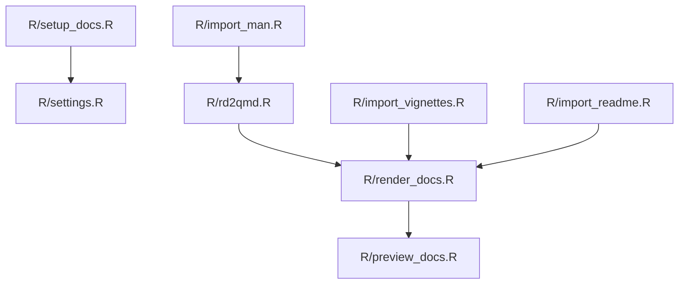

# etiennebacher/altdoc

> Paquet R qui crée un site de documentation pour un paquet R, avec Quarto, Docsify, MkDocs ou Docute.

## Le problème
Construire un site de documentation pour un paquet R avec vignettes, pages de référence et README demande des outils et des réglages dispersés.

## Ce que ça fait vraiment
setup_docs crée la structure du site selon l'outil choisi ; render_docs importe pages man, vignettes et README, les rend et assemble ; preview_docs ouvre un aperçu. Le déploiement GitHub Pages est possible via un fichier d'actions.

## Comment c'est branché


## Essayer
```r
install.packages("altdoc")
setup_docs(tool = "docsify")
render_docs()
preview_docs()
```

## Coût et pièges
Gratuit. Selon l'outil, il faut installer Quarto ou MkDocs. Licence non identifiée par GitHub.

## Ce que ce n'est pas
Pas un générateur pour tout langage : il vise les paquets R.

## Alternatives
- Aucune alternative nommée dans le README (il s'appuie sur Quarto, Docsify, MkDocs et Docute).

## Pour toi
Surveiller : utile seulement si tu publies des paquets R.

