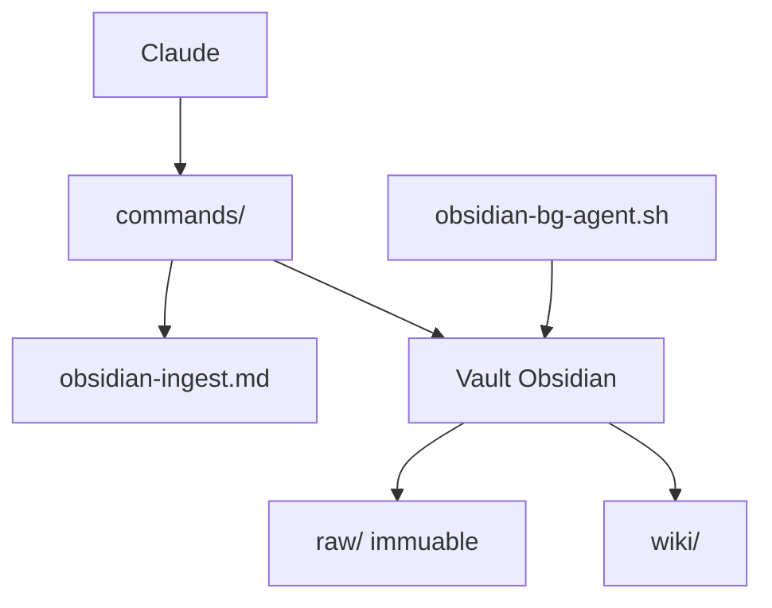

# eugeniughelbur/obsidian-second-brain

> Pack of skills and commands that gives Claude Code, Codex or Cursor a persistent memory in an Obsidian vault.

## The problem
Each agent session starts from scratch, and Obsidian notes stay out of the agent's reach.

## What it actually does
49 Markdown commands: saving, ingestion (URLs, PDFs, audio, images) that rewrites pages, contradiction reconciliation, vault health, reflection tools, research (X, Perplexity, YouTube). Four optional scheduled agents and one background agent. "Crew" shares a task log between agents.

## How it is wired


## Trying it
```bash
curl -fsSL https://raw.githubusercontent.com/eugeniughelbur/obsidian-second-brain/main/scripts/quick-install.sh | bash
# puis dans Claude Code : /crew setup
/plugin marketplace add eugeniughelbur/obsidian-second-brain
```

## Cost and gotchas
Research commands are paid per call (~$0.05 to $0.80). The background agent uses `--dangerously-skip-permissions`; it is inert by default.

## What it is not
Not an Obsidian plugin: a skill for a coding agent. The `curl | bash` installation script should be reviewed.

## Alternatives
Karpathy LLM Wiki (the model it draws inspiration from).

## For you
Worth watching: a good agent-memory idea, to be tested on a throwaway vault before arming the background agent.
