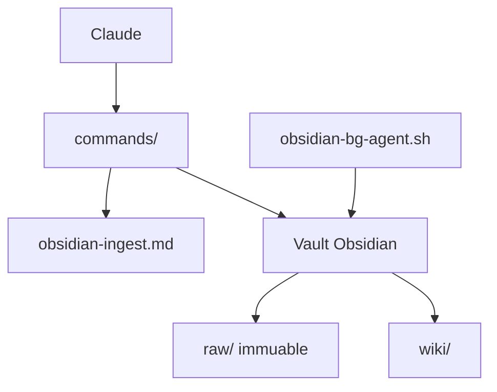

# eugeniughelbur/obsidian-second-brain

> Pack de skills et commandes qui donne à Claude Code, Codex ou Cursor une mémoire persistante dans un vault Obsidian.

## Le problème
Chaque session d'agent repart de zéro, et les notes Obsidian restent hors de portée de l'agent.

## Ce que ça fait vraiment
49 commandes Markdown : sauvegarde, ingestion (URL, PDF, audio, images) qui réécrit des pages, réconciliation de contradictions, santé du vault, outils de réflexion, recherche (X, Perplexity, YouTube). Quatre agents planifiés et un agent d'arrière-plan optionnels. « Crew » partage un journal de tâches entre agents.

## Comment c'est branché


## Essayer
```bash
curl -fsSL https://raw.githubusercontent.com/eugeniughelbur/obsidian-second-brain/main/scripts/quick-install.sh | bash
# puis dans Claude Code : /crew setup
/plugin marketplace add eugeniughelbur/obsidian-second-brain
```

## Coût et pièges
Commandes de recherche payantes à l'appel (~0,05 à 0,80 $). L'agent d'arrière-plan utilise `--dangerously-skip-permissions` ; il est inerte par défaut.

## Ce que ce n'est pas
Pas un plugin Obsidian : un skill pour agent de code. Le script d'installation en `curl | bash` est à relire.

## Alternatives
Karpathy LLM Wiki (le modèle dont il s'inspire).

## Pour toi
Surveiller : bonne idée de mémoire d'agent, à tester sur un vault jetable avant d'armer l'agent d'arrière-plan.

