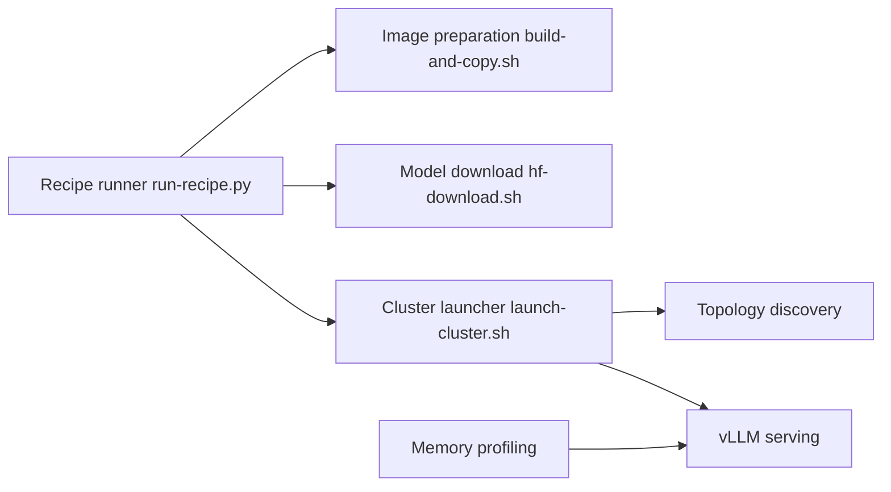

# eugr/spark-vllm-docker

> Docker image and scripts to run vLLM on NVIDIA DGX Spark, alone or in a cluster.

## The problem
Running the latest models on DGX Spark (GB10) across multiple nodes requires compiling vLLM and FlashInfer, and tuning NCCL and the network by hand.

## What it actually does
Scripts for building (`build-and-copy.sh`), downloading models with caching and distribution (`hf-download.sh`), launching a cluster (`launch-cluster.sh`, without Ray by default) and per-model YAML recipes (`run-recipe.sh`). It adds patch "mods", automatic node discovery and prebuilt images tested every night.

## How it is wired


## Trying it
```bash
git clone https://github.com/eugr/spark-vllm-docker.git
cd spark-vllm-docker
./run-recipe.sh recipes/qwen3.8-flash-next-nvfp4-solo.yaml --solo --setup
curl --fail http://localhost:8000/health
```

## Cost and gotchas
Requires DGX Spark hardware (arch 12.1a), Docker and passwordless SSH between nodes. Models weigh tens of GB. The README warns that things may break.

## What it is not
Not affiliated with NVIDIA. Not a generic tool: designed for GB10, other GPUs go through `--gpu-arch`. Several builds are experimental.

## Alternatives
The official `vllm/vllm-openai` or NGC images, usable via the `use-official-vllm` mod.

## For you
Worth watching: very useful if you own one or more DGX Sparks, pointless otherwise; a single maintainer and a fast pace of change.
