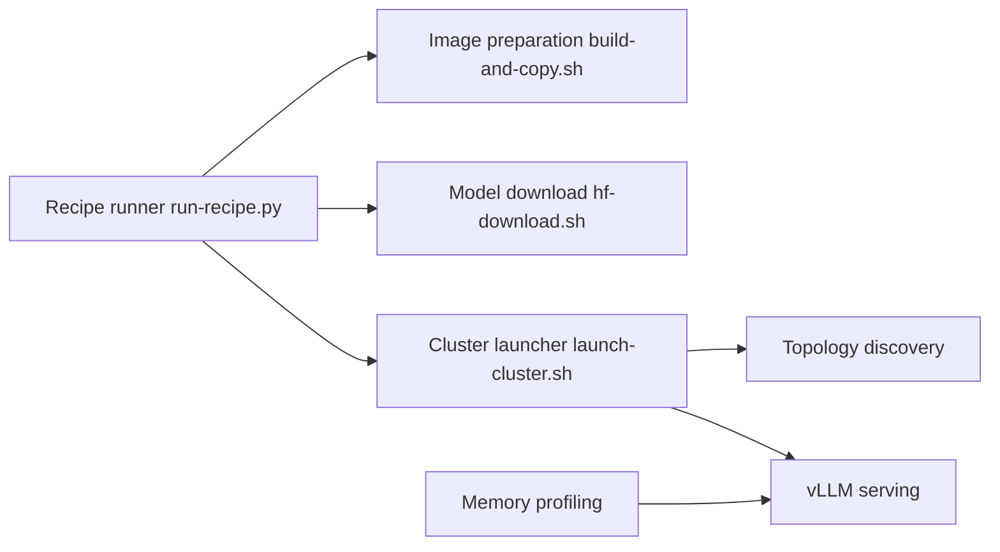

# eugr/spark-vllm-docker

> Image Docker et scripts pour lancer vLLM sur NVIDIA DGX Spark, seul ou en cluster.

## Le problème
Faire tourner les derniers modèles sur DGX Spark (GB10) en multi-nœuds demande de compiler vLLM et FlashInfer, régler NCCL et le réseau à la main.

## Ce que ça fait vraiment
Scripts de build (`build-and-copy.sh`), de téléchargement de modèles avec cache et distribution (`hf-download.sh`), de lancement de cluster (`launch-cluster.sh`, sans Ray par défaut) et des recettes YAML par modèle (`run-recipe.sh`). Il y ajoute des « mods » de patchs, la découverte automatique des nœuds et des images prébuildées testées chaque nuit.

## Comment c'est branché


## Essayer
```bash
git clone https://github.com/eugr/spark-vllm-docker.git
cd spark-vllm-docker
./run-recipe.sh recipes/qwen3.8-flash-next-nvfp4-solo.yaml --solo --setup
curl --fail http://localhost:8000/health
```

## Coût et pièges
Exige du matériel DGX Spark (arch 12.1a), Docker et SSH sans mot de passe entre nœuds. Les modèles se comptent en dizaines de Go. Le README prévient que des choses peuvent casser.

## Ce que ce n'est pas
Non affilié à NVIDIA. Pas un outil générique : conçu pour GB10, d'autres GPU passent par `--gpu-arch`. Plusieurs builds sont expérimentaux.

## Alternatives
Les images officielles `vllm/vllm-openai` ou NGC, utilisables via le mod `use-official-vllm`.

## Pour toi
Surveiller : très utile si tu possèdes un ou plusieurs DGX Spark, sans intérêt sinon ; un seul mainteneur et un rythme de changement rapide.

