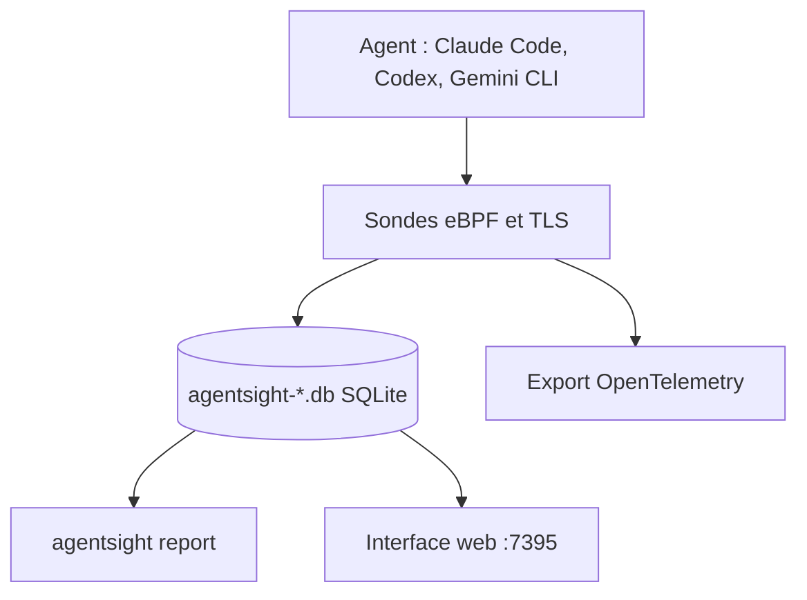

# eunomia-bpf/agentsight

> System-level observability for AI agents using eBPF, with no SDK, for anyone running Claude Code or Codex.

## The problem
An agent's logs rarely say what it actually did: which processes it launched, which files it changed, which servers it contacted.

## What it actually does
AgentSight watches an agent from the outside using eBPF and TLS traffic capture. It links model calls to processes, files and network connections. `top` gives a live view, `record` saves a session into a SQLite database, and `report` queries past sessions. An OpenTelemetry `gen_ai.*` export is available.

## How it is wired


## Trying it
```bash
cargo install agentsight
agentsight top
agentsight vis
sudo agentsight record -- claude
agentsight report
```

## Cost and gotchas
eBPF mode requires Linux (kernel 4.1 minimum, 5.0 recommended) and sudo or `CAP_BPF`. The databases may contain prompts, responses and headers: treat them as sensitive. The README claims less than 3% CPU overhead.

## What it is not
Not a prompt evaluation tool. It cannot capture IDE agents such as Cursor through eBPF. It does not replace application-level tracing when you own the code.

## Alternatives
- LangSmith: traces, prompts and evaluations when you control the application code.
- Langfuse: same use, on the application side.
- Helicone: a gateway, if you can route the provider's traffic.

## For you
Adopt it to audit what your coding agents do: it fills the gap that application-level tools leave, without modifying the agents.
