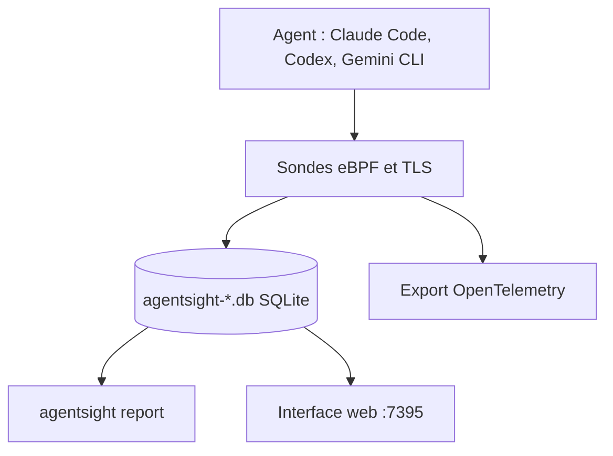

# eunomia-bpf/agentsight

> Observabilité système des agents IA par eBPF, sans SDK, pour qui exécute Claude Code ou Codex.

## Le problème
Les journaux d'un agent disent rarement ce qu'il a réellement fait : processus lancés, fichiers modifiés, serveurs contactés.

## Ce que ça fait vraiment
AgentSight observe un agent depuis l'extérieur avec eBPF et capture du trafic TLS. Il relie les appels au modèle aux processus, fichiers et connexions réseau. `top` donne une vue en direct, `record` enregistre une session dans une base SQLite, `report` interroge les sessions passées. Un export OpenTelemetry `gen_ai.*` est disponible.

## Comment c'est branché


## Essayer
```bash
cargo install agentsight
agentsight top
agentsight vis
sudo agentsight record -- claude
agentsight report
```

## Coût et pièges
Le mode eBPF demande Linux (noyau 4.1 minimum, 5.0 conseillé) et sudo ou `CAP_BPF`. Les bases peuvent contenir prompts, réponses et en-têtes : à traiter comme sensibles. Le README annonce moins de 3 % de surcharge CPU.

## Ce que ce n'est pas
Pas un outil d'évaluation de prompts. Il ne capte pas les agents d'IDE comme Cursor par eBPF. Il ne remplace pas un traçage applicatif quand tu possèdes le code.

## Alternatives
- LangSmith : traces, prompts et évaluations quand tu maîtrises le code applicatif.
- Langfuse : même usage, côté application.
- Helicone : passerelle, si tu peux router le trafic du fournisseur.

## Pour toi
À adopter pour auditer ce que font tes agents de code : il comble le trou que les outils applicatifs laissent, sans modifier les agents.

