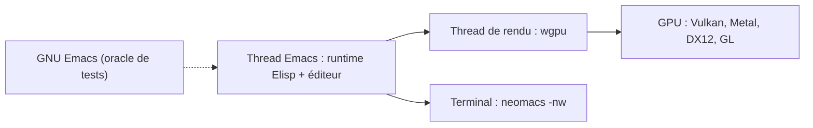

# eval-exec/neomacs

> Rewrite of Emacs in Rust with GPU rendering, meant to stay compatible with your Emacs config.

## The problem
Emacs's core is written in C (about 300,000 lines) and its display engine does not lend itself to graphical effects or embedded media; changing them remains difficult.

## What it actually does
NEO Emacs replaces the C core with Rust (Elisp evaluator, bytecode machine, GC, portable dump) and the display with a wgpu engine: cursor and scroll animations, inline images and 4K video, a WPE WebKit browser, an Alacritty terminal, WGSL shaders. GNU Emacs serves as the test oracle; the announced compatibility is about 95%. Terminal mode (-nw) and a headless daemon are available.

## How it is wired


## Trying it
```bash
git clone https://github.com/eval-exec/neomacs && cd neomacs
nix develop --accept-flake-config
cargo xtask fresh-build --release
./target/release/neomacs
```

## Cost and gotchas
Free. Linux packages (.deb, .rpm, AppImage), macOS and Windows are experimental, with Docker images for terminal and batch use. Building from source requires Rust, with Nix recommended. Older .deb files and tarballs (v0.0.20 and earlier) have file ownership problems, detailed in the README.

## What it is not
Not a stable editor: the README warns of rough edges and breaking changes. Elisp multi-threading and pauseless GC are still research. Windows is waiting for testing.

## Alternatives
- GNU Emacs: stable, and keeping it installed allows you to roll back.

## For you
Ignore: an experimental editor with a single maintainer brings nothing to your data / AI work, and GNU Emacs already covers the need.
