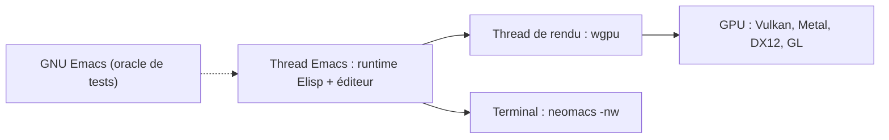

# eval-exec/neomacs

> Réécriture d'Emacs en Rust avec affichage sur GPU, censée rester compatible avec ta config Emacs.

## Le problème
Le cœur d'Emacs est en C (environ 300 000 lignes) et son moteur d'affichage ne se prête pas aux effets graphiques ni aux médias intégrés ; les modifier reste difficile.

## Ce que ça fait vraiment
NEO Emacs remplace le cœur C par du Rust (évaluateur Elisp, machine à bytecode, GC, dump portable) et l'affichage par un moteur wgpu : animations de curseur et de défilement, images et vidéo 4K en ligne, navigateur WPE WebKit, terminal Alacritty, shaders WGSL. GNU Emacs sert d'oracle de tests ; la compatibilité annoncée est d'environ 95 %. Mode terminal (-nw) et démon sans tête disponibles.

## Comment c'est branché


## Essayer
```bash
git clone https://github.com/eval-exec/neomacs && cd neomacs
nix develop --accept-flake-config
cargo xtask fresh-build --release
./target/release/neomacs
```

## Coût et pièges
Gratuit. Paquets Linux (.deb, .rpm, AppImage), macOS et Windows expérimentaux, images Docker pour terminal et batch. La compilation depuis les sources demande Rust, Nix conseillé. Les anciens .deb et tarballs (v0.0.20 et avant) ont des problèmes de propriété des fichiers, détaillés dans le README.

## Ce que ce n'est pas
Pas un éditeur stable : le README prévient de bords rugueux et de changements cassants. Le multi-threading Elisp et le GC sans pause sont encore en recherche. Windows attend des tests.

## Alternatives
- GNU Emacs : stable, et le garder installé permet le retour arrière.

## Pour toi
À ignorer : un éditeur expérimental à mainteneur unique n'apporte rien à ton travail data / IA, et GNU Emacs couvre déjà le besoin.

