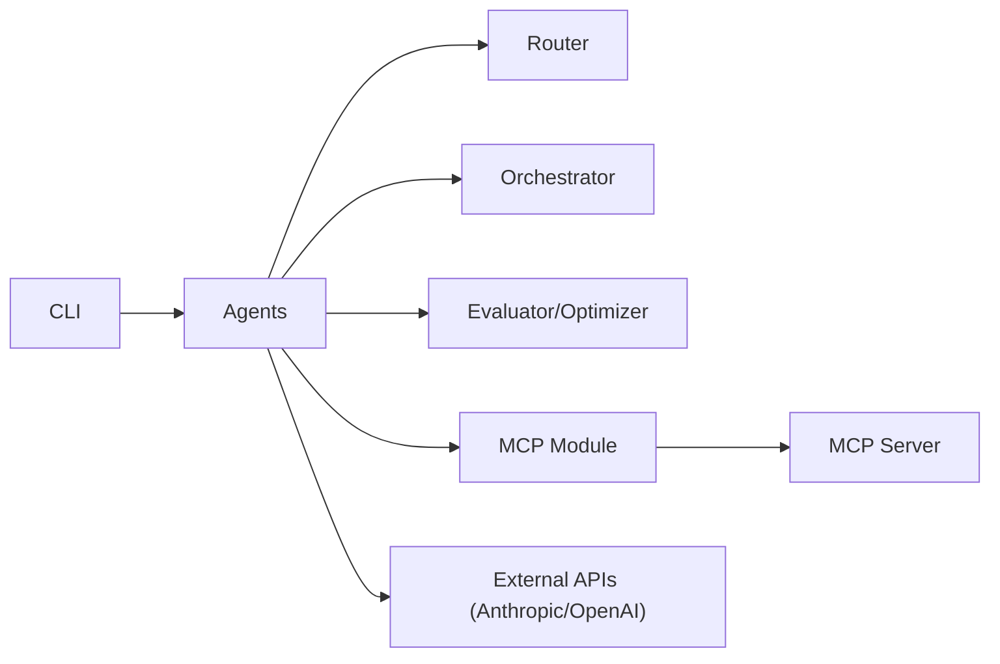

# evalstate/fast-agent

> Python framework and CLI to compose agents and workflows connected to MCP servers.

## The problem
Connecting LLMs to MCP servers, with agent chains, routing and human validation, requires a lot of glue code.

## What it actually does
Agents are declared with decorators (`@fast.agent`) and combined: `chain`, `parallel`, `evaluator_optimizer`, `router`, `orchestrator`, `maker` (k-vote) and "agents as tools". MCP servers are declared in `fast-agent.yaml`, with OAuth (PKCE, system keyring) and HTTP transport diagnostics. It supports Anthropic, OpenAI, Google, Azure, Ollama, DeepSeek. Skills (`SKILL.md`), a shell mode and an MCP server mode are included.

## How it is wired


## Trying it
```bash
uvx fast-agent-mcp@latest -x
uv tool install -U fast-agent-mcp
fast-agent go
fast-agent scaffold
fast-agent quickstart workflow
uv run agent.py --model sonnet
```

## Cost and gotchas
LLM calls are at your expense (provider key). Without a configured model, an interactive session opens a selector; automated runs require `--model` or `FAST_AGENT_MODEL`. The architecture description still cites `src/mcp_agent`, a trace of the lineage with mcp-agent.

## What it is not
It is not a finished product for non-technical users: it is a developer framework. The claims "first framework with full MCP support" and "only tool that inspects the HTTP transport" are the author's, without proof.

## Alternatives
- mcp-agent: the project fast-agent draws inspiration from and derives from.
- OpenAI Agents SDK: source of inspiration for the "agents as tools" pattern.

## For you
Worth watching: covers MCP agent workflows well, but has a single maintainer and significant overlap with other frameworks; try it on a specific MCP case before adopting it.
