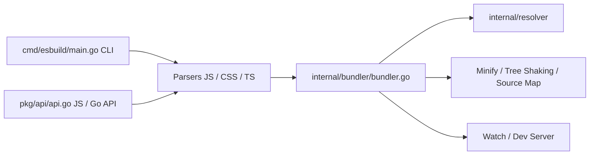

# evanw/esbuild

> JavaScript, CSS, TypeScript and JSX bundler written in Go, very fast, for web developers.

## The problem
According to the README, web build tools are 10 to 100 times slower than they could be.

## What it actually does
Minimal README (under 800 characters). It announces: bundling of ESM and CommonJS modules, CSS and CSS modules, tree shaking, minification, source maps, local server, watch mode, plugins, with a command-line, JS and Go API. Based on the architecture: JS/CSS/TS parsers, module graph, dependency resolver, transformation stages, cache, watch and dev server.

## How it is wired


## Trying it
```bash
# Aucune commande documentée dans le README ; renvoi aux instructions de démarrage du site
```

## Cost and gotchas
Free (MIT). The README gives no details on installation or options: everything is deferred to the external documentation.

## What it is not
Not a TypeScript type checker, not a framework: a build tool.

## Alternatives
- No alternative named in the README.

## For you
Ignore: a front-end bundler has no place in a data/AI/MLOps workflow, unless you are building a web interface.
