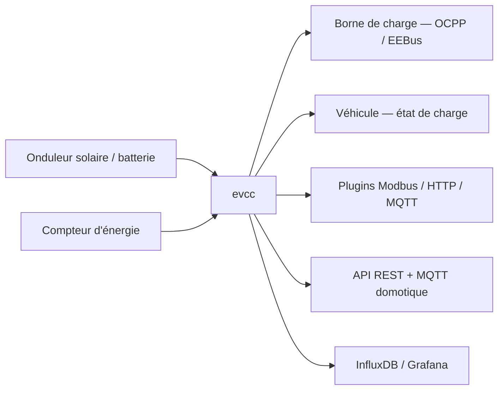

# evcc-io/evcc

> Electric vehicle charge controller and home energy management, cloud-free.

## The problem
Charging your car on your own solar power means getting a charger, an inverter, a meter and the vehicle to talk to each other — each with its own protocol, and often through a manufacturer cloud that may disappear.

## What it actually does
Drives charging according to local production and household consumption, with a simple web interface. The project's strength is hardware coverage: over a hundred chargers (EEBus and OCPP included, plus DIY Phoenix Contact and EVSE DIN builds), smart plugs, heat pumps and electric heaters, solar inverters and batteries, general-purpose energy meters, SunSpec and mbmd devices, and the state of charge of most vehicle brands. Whatever is not covered plugs in through plugins: Modbus, HTTP, MQTT, JavaScript, WebSocket, Go or shell script. Telegram or PushOver notifications, InfluxDB and Grafana logging, REST API and MQTT for home automation.

## How it is wired


## Trying it
```bash
# Aucune commande documentée dans le README : il renvoie entièrement à la documentation
# du projet pour l'installation et la configuration.
```

## Cost and gotchas
The software is free; all the cost is hardware. Vehicle integrations often go through manufacturer services despite the "cloud-free" goal, and the README does not say which ones. The Home Assistant and openHAB extensions are **not maintained by the core team**.

## What it is not
It is not a guaranteed universal driver: a listed brand does not mean all its models. It is not a turnkey solution — configuration is done in YAML, outside the README.

## Alternatives
No alternative named in the README; openWB and Home Assistant appear as supported hardware or extensions, not as competitors.

## For you
Home project, unrelated to professional data or AI use.
