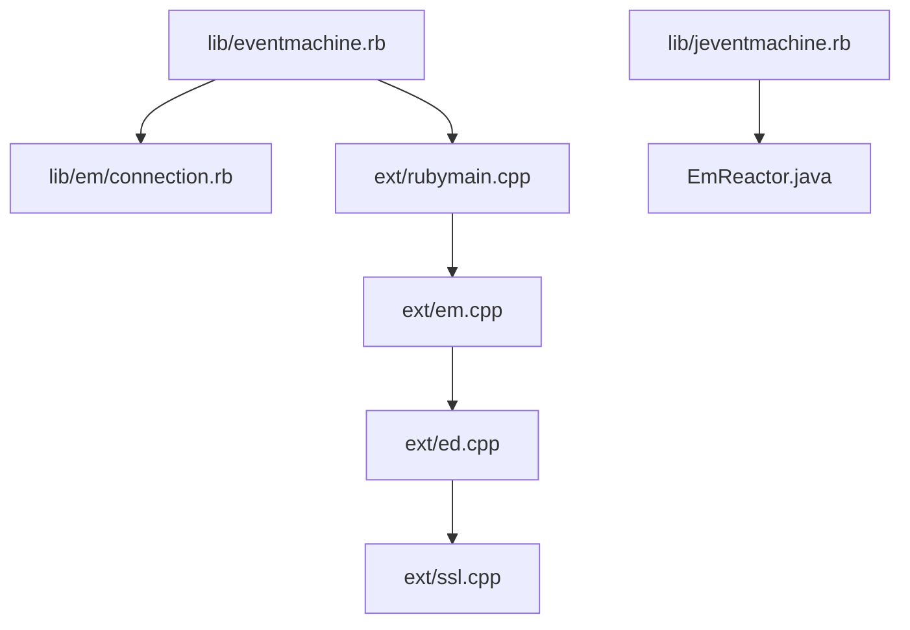

# eventmachine/eventmachine

> Ruby event-driven I/O library for concurrent network servers and clients.

## The problem
Writing concurrent network servers with threads is complex and does not scale well.

## What it actually does
It applies the Reactor pattern: the Ruby API (`lib/eventmachine.rb`) calls a C++ reactor (`em.cpp` for the loop, `ed.cpp` for descriptors, `ssl.cpp` for TLS). Under JRuby, a Java reactor (`EmReactor`) takes over. It is used for servers, asynchronous clients, proxies and file watching.

## How it is wired
Diagram based on the one provided.



## Trying it
```ruby
gem install eventmachine

require 'eventmachine'
EventMachine.run {
  EventMachine.start_server "127.0.0.1", 8081, EchoServer
}
```
The `EchoServer` module is defined in the README.

## Cost and gotchas
Free. A C++ extension is compiled when the gem is installed, Ruby required. Documentation is limited to a reference and a wiki.

## What it is not
Not a web framework: a low-level foundation, which Thin or Goliath use. 201 open issues.

## Alternatives
- Celluloid: cited by the README for those dissatisfied with EventMachine.

## For you
Ignore: asynchronous Ruby, unrelated to your work; in Python, asyncio does the same job.
